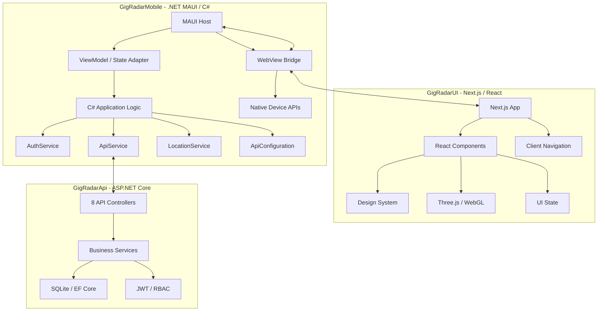
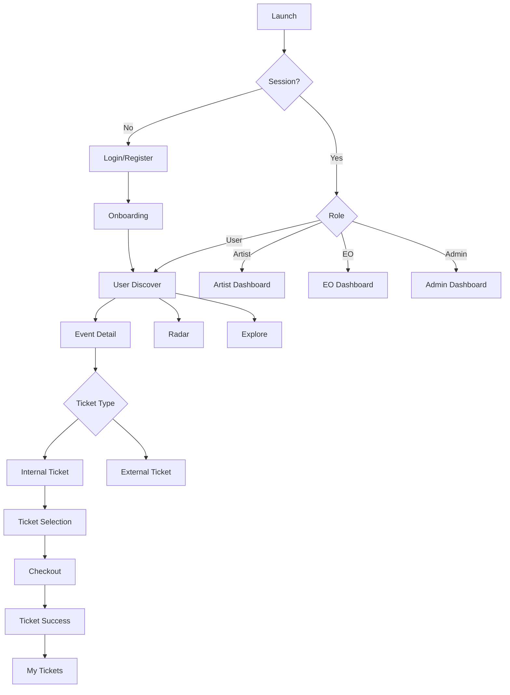
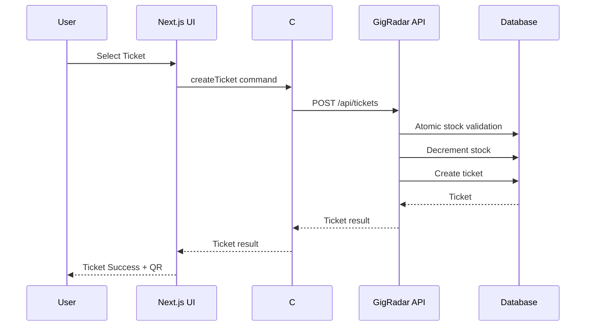
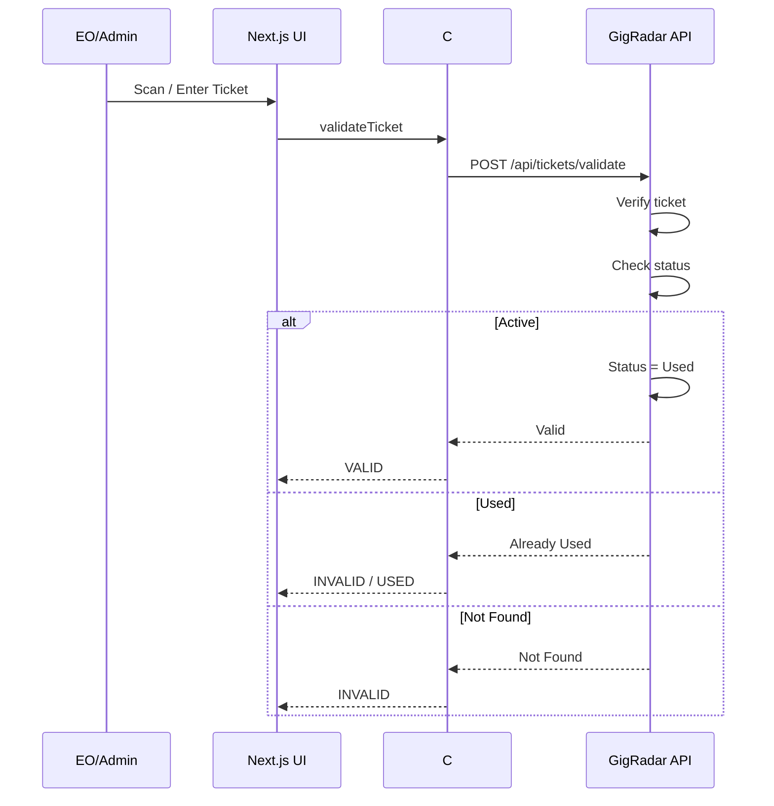

# GigRadar UI/UX Rebuild Specification
## Next.js + React + Three.js UI Layer dengan C# .NET MAUI sebagai Host & Logic Layer

> **Status:** Draft UI/UX Rebuild v1.0  
> **Tanggal:** Oktober 2026  
> **Basis:** `PRD.md`, `GAMBARAN_LENGKAP_APLIKASI.md`, `REKAPAN_APLIKASI.md`, `README.md`  
> **Scope:** Rebuild total Presentation/UI/UX dari nol tanpa mengubah fungsi bisnis utama GigRadar.

---

# 1. Tujuan Dokumen

Dokumen ini mendefinisikan pembangunan ulang total antarmuka GigRadar.

Yang berubah:

- seluruh visual UI;
- struktur komponen UI;
- design system;
- layout;
- interaction design;
- motion;
- responsive behavior;
- radar visualization;
- ticket visualization;
- navigation presentation;
- dashboard presentation;
- UX flow antar-screen.

Yang **tidak berubah**:

- fungsi bisnis GigRadar;
- role User, Artist, EO, Admin;
- authentication dan JWT;
- role request;
- onboarding genre;
- discovery;
- LBS;
- radar;
- event detail;
- favorite/follow;
- ticketing;
- checkout;
- ticket validation;
- Artist Hub;
- EO management;
- Admin governance;
- REST API;
- database;
- entity/model;
- aturan keamanan;
- aturan kepemilikan data;
- business logic C#/.NET.

Prinsip utama:

> **UI berubah 100%. Perilaku bisnis tetap 100% kompatibel dengan sistem GigRadar yang sudah ada.**

---

# 2. Baseline Sistem yang Harus Dipertahankan

GigRadar saat ini merupakan ekosistem digital untuk skena musik independen, gigs, showcase, cafe gigs, dan festival independen.

Sistem memiliki empat role:

| Role | Fungsi utama |
|---|---|
| User | Menemukan event, melihat artist, menyimpan event, mengikuti artist, membeli tiket |
| Artist | Mengelola profil band, track, album, post, journey, member, dan event lineup |
| EO | Mengelola event, venue, ticket type, analytics, dan validasi tiket |
| Admin | Moderasi role, direktori user, dan pengelolaan event global |

Backend tetap:

- ASP.NET Core Web API .NET 8
- JWT Bearer Authentication
- BCrypt password hashing
- SQLite + EF Core 8
- 17 DbSets
- 8 controllers
- 32+ REST endpoints

Client logic tetap:

- .NET MAUI .NET 10
- C#
- MVVM
- `ApiService`
- `AuthService`
- `LocationService`
- `ApiConfiguration`
- `ShellRouter`
- native device capability
- local session/token management
- permission handling
- API communication
- lifecycle
- crash handling

---

# 3. Arsitektur UI Baru

## 3.1 Arsitektur Target

UI baru menggunakan:

- Next.js
- React
- TypeScript
- CSS/Tailwind atau CSS Modules
- Three.js untuk visualisasi 3D/immersive bila diperlukan
- WebView sebagai presentation surface di dalam .NET MAUI

Arsitektur target:



## 3.2 Prinsip Penting

Next.js **bukan** sumber business logic.

Next.js bertanggung jawab atas:

- rendering UI;
- interaction UI;
- animation;
- visual hierarchy;
- client-side presentation state;
- responsive layout;
- Three.js rendering;
- form presentation;
- loading state;
- empty state;
- error state.

C# bertanggung jawab atas:

- business rules;
- authentication;
- token;
- authorization;
- API calls;
- device permission;
- geolocation;
- session;
- native lifecycle;
- bridge command;
- platform capability.

Backend bertanggung jawab atas:

- persistence;
- validation;
- ownership;
- transaction;
- stock;
- ticket generation;
- ticket validation;
- RBAC enforcement.

---

# 4. Catatan Arsitektur Next.js + MAUI

Next.js tidak boleh diperlakukan sebagai backend kedua.

Untuk aplikasi MAUI:

```text
MAUI App
   |
   +-- WebView
          |
          +-- GigRadarUI
                |
                +-- Next.js
                +-- React
                +-- Three.js
```

Untuk deployment UI embedded, aplikasi UI harus dapat dibuild menjadi asset web yang dapat disajikan oleh WebView.

Next.js Server Actions, Next.js API Routes, atau database access dari Next.js **bukan bagian dari business architecture GigRadar**.

Jika suatu fitur membutuhkan data:

```text
React UI
   ↓
MAUI Bridge
   ↓
C# Service
   ↓
GigRadarApi
```

Bukan:

```text
React UI
   ↓
Database
```

---

# 5. UI Bridge Contract

Bridge menjadi batas antara presentation layer dan C#.

Contoh konsep command:

```text
auth.getSession
auth.login
auth.logout

events.getNearby
events.getTonight
events.getWeekend
events.getRecommended
events.getDetail

favorites.toggle
artists.getDetail
artists.follow

tickets.getMyTickets
tickets.create
tickets.validate

location.request
location.getCurrent

navigation.open
system.share
system.openExternalLink
```

Response:

```json
{
  "success": true,
  "data": {},
  "error": null
}
```

Error:

```json
{
  "success": false,
  "data": null,
  "error": {
    "code": "TICKET_SOLD_OUT",
    "message": "Tiket sudah habis."
  }
}
```

UI tidak boleh mengetahui detail database.

---

# 6. Filosofi UI/UX Baru

UI baru tidak mencoba meniru XAML lama.

UI dibuat ulang sebagai produk digital modern dengan karakter:

- underground;
- editorial;
- cinematic;
- dark;
- energetic;
- community-driven;
- information-dense tetapi tidak berantakan;
- visual hierarchy kuat;
- motion yang terkontrol;
- typography expressive;
- event poster sebagai visual utama.

Arah visual:

```text
Underground Music Culture
        +
Editorial Digital Product
        +
Spatial Discovery
        +
Modern Event Platform
```

---

# 7. Design Direction

## 7.1 Visual Identity

Tema dasar:

- dark zinc;
- near-black;
- muted gray;
- signal lime sebagai accent;
- white/off-white untuk typography;
- genre accent sebagai warna sekunder.

Signal Lime digunakan untuk:

- CTA;
- active state;
- selected state;
- radar sweep;
- confirmation;
- important interactive element.

Jangan menggunakan signal lime pada seluruh interface.

Tujuannya adalah membuat lime terasa seperti:

> "signal"

bukan warna background utama.

---

# 8. Typography

Gunakan hierarchy:

```text
Display
   ↓
H1
   ↓
H2
   ↓
H3
   ↓
Body
   ↓
Caption
   ↓
Metadata
```

Rekomendasi:

- Display: Space Grotesk
- UI/body: Inter

Karakter typography:

- tegas;
- compact;
- mudah dibaca;
- angka tiket harus sangat jelas;
- metadata tidak boleh bersaing dengan event title.

---

# 9. Spacing System

Gunakan base unit 4.

```text
4
8
12
16
20
24
32
40
48
64
80
96
```

Rules:

- screen padding mobile: 16–20;
- card padding: 16–20;
- section gap: 32–48;
- major section gap: 56–80;
- touch target minimum: 44x44.

---

# 10. Radius System

Gunakan radius sebagai bagian dari identity.

```text
Small      8
Medium     12
Card       16
Large      24
Pill       999
```

Poster/event image dapat menggunakan radius lebih besar.

CTA utama tidak perlu selalu pill.

---

# 11. Elevation & Surface

Gunakan surface hierarchy:

```text
Background
   ↓
Surface
   ↓
Elevated Surface
   ↓
Focused Surface
```

Hindari shadow berat.

Gunakan:

- border;
- blur;
- subtle glow;
- contrast;
- transparency.

---

# 12. Motion System

Motion harus membantu orientasi.

Durasi:

```text
Micro       120–180ms
Normal      200–300ms
Emphasis    350–500ms
Page        400–700ms
```

Motion yang diperbolehkan:

- fade;
- slide;
- scale;
- blur;
- card expansion;
- radar sweep;
- hover/focus;
- bottom sheet transition;
- tab indicator.

Tidak boleh:

- animasi berlebihan;
- infinite animation pada elemen tidak penting;
- parallax berat;
- WebGL berat di seluruh aplikasi.

Support:

```text
prefers-reduced-motion
```

Jika reduced motion aktif:

- radar sweep diperlambat atau dihentikan;
- page transition menjadi fade;
- decorative motion dimatikan.

---

# 13. Information Architecture

## 13.1 Public / Authentication

```text
Splash
 ├── Login
 ├── Register
 └── Role Request
```

## 13.2 User

```text
Home / Discover
Explore
Radar
Tickets
Profile
```

Detail routes:

```text
Event Detail
Artist Detail
Ticket Selection
Checkout
Ticket Success
Ticket Detail
Favorites
Following
```

## 13.3 Artist

```text
Artist Dashboard
Artist Profile
Tracks
Albums
Posts
Journey
Members
Events
```

## 13.4 EO

```text
EO Dashboard
Events
Create Event
Edit Event
Ticket Types
Analytics
Venue
Gate Validation
Profile
```

## 13.5 Admin

```text
Admin Dashboard
Role Requests
Users
Events
Event Management
Moderation
Profile
```

---

# 14. Dynamic Role Navigation

Navigation tetap mengikuti role.

## User

```text
Discover | Explore | Radar | Tickets | Profile
```

## EO

```text
Dashboard | Events | Tickets | Analytics | Profile
```

## Artist

```text
Dashboard | Profile
```

Halaman Artist Dashboard memiliki secondary navigation:

```text
Overview
Music
Albums
Posts
Journey
Members
Events
```

## Admin

```text
Dashboard | Events | Tickets | Users | Profile
```

UI boleh berubah total, tetapi role routing tetap.

---

# 15. Screen Specification

## 15.1 Splash

Tujuan:

- bootstrap session;
- restore token;
- cek role;
- menentukan destination.

Visual:

- logo GigRadar;
- minimal;
- dark;
- subtle signal animation.

Flow:

```text
Splash
   |
   +-- no session --> Login
   |
   +-- User + onboarding incomplete --> Onboarding
   |
   +-- User --> User Home
   |
   +-- Artist --> Artist Dashboard
   |
   +-- EO --> EO Dashboard
   |
   +-- Admin --> Admin Dashboard
```

---

# 16. Login

Elemen:

- logo;
- email;
- password;
- show/hide password;
- login button;
- register link;
- loading state;
- error state.

UX:

```text
Input
 ↓
Validate
 ↓
C# AuthService
 ↓
POST /auth/login
 ↓
JWT
 ↓
Role Resolution
 ↓
Destination
```

Jangan membuat login UI bergantung pada endpoint langsung dari React.

---

# 17. Register

Field:

- name;
- email;
- password;
- requested role.

Role:

```text
User
Artist
EO
```

Jika Artist/EO:

```text
Register
 ↓
Account created
 ↓
RoleRequest = Pending
 ↓
Current effective role = User
```

UI harus menjelaskan bahwa role membutuhkan approval Admin.

---

# 18. Onboarding

Genre:

1. Indie
2. Alternative
3. Rock
4. Punk
5. Hardcore
6. Shoegaze
7. Emo
8. Metal
9. Jazz
10. Folk
11. Electronic
12. Pop

Interaction:

```text
Select genre
 ↓
Selected state
 ↓
Minimum 1
 ↓
Continue
 ↓
Save UserPreferences
 ↓
User Home
```

Visual:

- grid;
- genre tile;
- icon;
- label;
- selected ring;
- subtle accent.

---

# 19. User Home / Discover

Ini adalah screen utama.

Struktur:

```text
Top Bar
 ├── Greeting
 ├── Location status
 └── Profile shortcut

Hero
 └── Featured / Tonight

Quick Filters
 ├── Nearby
 ├── Tonight
 ├── Weekend
 └── Recommended

Event Feed
 ├── Event Card
 ├── Event Card
 └── Event Card

Artist discovery
 └── Horizontal artist cards
```

Prioritas informasi:

```text
What
When
Where
Distance
Price
Genre
```

---

# 20. Event Card

Event card wajib menampilkan:

- poster;
- event name;
- date;
- venue;
- distance jika tersedia;
- genre;
- starting price;
- favorite;
- ticket availability.

States:

```text
Available
Low Stock
Sold Out
Completed
Draft
```

Draft tidak tampil pada public discovery.

---

# 21. Explore

Explore adalah discovery yang lebih eksploratif.

Fitur:

- search;
- genre filter;
- date filter;
- distance filter;
- event list;
- artist list;
- venue discovery.

Search hierarchy:

```text
Search GigRadar
        |
        +-- Events
        +-- Artists
        +-- Venues
```

---

# 22. Radar

Radar merupakan signature UI GigRadar.

Teknologi:

- React;
- Three.js/WebGL jika mode spatial digunakan;
- fallback 2D Canvas untuk device rendah;
- C# tetap menangani geolocation;
- C# tetap melakukan bridge untuk data location.

Flow:

```text
Open Radar
 ↓
Request foreground location
 ↓
Permission granted?
 ├── Yes → current location
 └── No → fallback coordinate
 ↓
Get nearby events
 ↓
Calculate / receive distance + bearing
 ↓
Render nodes
```

Radar tidak boleh menyimpan koordinat user secara permanen.

---

# 23. Radar UX

Visual:

```text
             Event
               •
        ┌─────────────┐
        │    ╱        │
        │   ╱  •      │
        │  ◉          │
        │      •      │
        └─────────────┘
             User
```

Node:

- genre-coded;
- glowing;
- size mengikuti importance/distance;
- accessible label;
- touch target minimal 44px.

Tap node:

```text
Node
 ↓
Quick Preview
 ├── Poster
 ├── Event
 ├── Venue
 ├── Distance
 └── View Event
```

Three.js digunakan untuk visual enhancement, bukan untuk mengganti perhitungan geospatial C#.

---

# 24. Event Detail

Hierarki:

```text
Hero Poster
 ↓
Event Title
 ↓
Date / Time
 ↓
Venue
 ↓
Artist Lineup
 ↓
Description
 ↓
Ticket Options
 ↓
Organizer
 ↓
Location
 ↓
CTA
```

CTA:

```text
Get Ticket
```

Jika external ticket link:

```text
Buy External Ticket
```

Jika internal:

```text
Choose Ticket
```

Favorite:

```text
♡ Save Event
♥ Saved
```

---

# 25. Artist Detail

Hero:

- cover;
- avatar;
- artist name;
- genre;
- city;
- followers;
- follow button.

Sections:

```text
About
Music
Albums
Posts
Journey
Members
Upcoming Events
```

Audio preview:

- 30-second preview;
- play/pause;
- progress;
- track metadata.

---

# 26. Ticket Selection

Flow 3 tahap tetap.

```text
01 Select
02 Checkout
03 Success
```

Ticket card:

```text
Category
Description
Price
Remaining stock
Quantity
```

State:

```text
Available
Low Stock
Sold Out
```

Sold out:

- disabled;
- visually clear;
- cannot be selected.

---

# 27. Checkout

Field:

- Full Name;
- Phone;
- Email;
- Date of Birth.

Validation:

- name minimum 3 characters;
- phone minimum 9 digits;
- valid email;
- age >= 17.

Summary:

```text
Event
Ticket Type
Quantity
Price
Total
```

Payment saat ini tetap mengikuti backend existing:

> simulated success / direct ticket creation.

UI harus memisahkan:

```text
Order Review
Payment State
Ticket Creation
```

sehingga gateway eksternal dapat ditambahkan nanti tanpa merombak UI.

---

# 28. Ticket Success

Success screen:

```text
Success
Your ticket is ready

Event
Date
Venue

Ticket ID

[ QR CODE ]

[ Add to Wallet / Save ]
[ View Ticket ]
```

QR visual baru sebaiknya menggunakan QR matrix standar.

Backend tetap menjadi sumber ticket code.

---

# 29. My Tickets

Tabs:

```text
Upcoming
Past
```

Ticket card:

- event;
- date;
- venue;
- status;
- ticket ID.

Ticket status:

```text
Active
Used
```

Ticket detail:

```text
QR
Ticket Information
Event Information
Buyer Information
Status
```

QR tidak boleh menjadi sumber validasi lokal.

---

# 30. Gate Validation

Role:

- EO;
- Admin.

Mode:

```text
Scan QR
OR
Manual Ticket Code
```

Result:

### Valid

```text
VALID TICKET
Name
Event
Ticket Type
Status: ACTIVE
```

Backend mengubah:

```text
Active → Used
```

### Already Used

```text
TICKET ALREADY USED
```

### Invalid

```text
INVALID TICKET
```

UI harus membuat hasil validasi sangat cepat dibaca saat kondisi venue ramai.

---

# 31. EO Dashboard

Metric cards:

```text
Total Events
Upcoming Events
Tickets Sold
Gross Revenue
```

Charts:

- ticket sales;
- revenue;
- event performance.

Quick actions:

```text
Create Event
Manage Events
Manage Tickets
Gate Validation
```

---

# 32. EO Events

List:

```text
Published
Draft
SoldOut
Completed
```

Event management:

```text
View
Edit
Delete
Manage Tickets
Analytics
```

EO hanya boleh memodifikasi event miliknya.

Ownership tetap diverifikasi backend.

---

# 33. Create Event

Wizard UI:

```text
01 Basic Info
02 Venue
03 Lineup
04 Ticket Types
05 Publish
```

Basic:

- event name;
- description;
- poster;
- date;
- time.

Venue:

- existing venue;
- custom venue.

Lineup:

- artist selection.

Ticket:

- category;
- description;
- price;
- stock;
- sort order.

Final:

```text
Save Draft
Publish
```

---

# 34. Ticket Management EO

Table/card:

```text
Ticket Type
Price
Stock
Sold
Remaining
Revenue
Status
```

Actions:

```text
Edit
Disable
```

Stock harus tetap divalidasi backend.

---

# 35. EO Analytics

Dashboard:

```text
GMV
Tickets Sold
Conversion
Event Attendance
```

Visualisasi:

- line chart;
- bar chart;
- KPI cards.

Charts adalah presentation only.

Angka berasal dari backend.

---

# 36. Artist Dashboard

Hero:

```text
Artist Profile
Followers
Upcoming Events
Latest Release
```

Quick actions:

```text
Edit Profile
Add Track
Create Album
New Post
Add Journey
Manage Members
```

---

# 37. Artist Music

Track list:

```text
Track
Duration
Preview
Album
```

Player:

- play;
- pause;
- seek;
- progress.

Audio tetap preview 30 detik sesuai fungsi existing.

---

# 38. Artist Albums

Album card:

- cover;
- title;
- release date;
- track count.

Album detail:

```text
Cover
Title
Description
Track List
```

---

# 39. Artist Posts

Post:

- cover/image;
- title;
- content;
- published date.

Use cases:

- release announcement;
- rehearsal;
- merchandise;
- band update.

---

# 40. Artist Journey

Timeline:

```text
Formation
   ↓
First Single
   ↓
First Show
   ↓
Tour
   ↓
Nomination
```

Each milestone:

- title;
- date;
- description;
- optional image.

---

# 41. Artist Members

Member card:

```text
Photo
Name
Instrument / Role
Joined Year
```

---

# 42. Admin Dashboard

Admin UI harus terasa sebagai control center, bukan user-facing entertainment UI.

Sections:

```text
Platform Overview
Role Requests
Users
Events
Moderation
```

---

# 43. Role Requests

Queue:

```text
Applicant
Email
Requested Role
Submitted
Status
```

Actions:

```text
Approve
Reject
```

Jika approve:

```text
RoleStatus → Approved
Role → Requested Role
```

User tetap harus mendapatkan role baru melalui mekanisme backend yang existing.

---

# 44. Users

Directory:

- name;
- email;
- role;
- verification/status;
- city;
- registration date.

Filter:

```text
All
User
Artist
EO
Admin
```

---

# 45. Admin Events

Admin dapat melihat event global.

Actions sesuai permission:

```text
View
Edit
Delete
Moderate
```

Admin tidak dibatasi ownership seperti EO.

---

# 46. Profile

Profile user:

```text
Avatar
Name
Email
Role
Preferences
Favorites
Following
Settings
Logout
```

Settings:

```text
Appearance
Motion
Notifications
Privacy
About
```

---

# 47. Responsive Strategy

UI dirancang untuk:

- Android;
- iOS;
- Windows;
- macOS.

Breakpoint konsep:

```text
Compact
   < 600

Medium
   600–1024

Expanded
   > 1024
```

Mobile:

- bottom navigation;
- stacked cards;
- bottom sheets.

Desktop:

- sidebar;
- multi-column layout;
- wider dashboard;
- persistent navigation.

Radar desktop dapat menggunakan area lebih besar.

---

# 48. Component Architecture

Struktur Next.js:

```text
GigRadarUI/
├── app/
│   ├── auth/
│   ├── user/
│   ├── artist/
│   ├── eo/
│   ├── admin/
│   └── event/
│
├── components/
│   ├── ui/
│   ├── layout/
│   ├── event/
│   ├── artist/
│   ├── ticket/
│   ├── radar/
│   ├── dashboard/
│   └── forms/
│
├── features/
│   ├── auth/
│   ├── discovery/
│   ├── radar/
│   ├── tickets/
│   ├── artists/
│   ├── eo/
│   └── admin/
│
├── bridge/
│   ├── mauiBridge.ts
│   ├── commands.ts
│   └── types.ts
│
├── hooks/
├── lib/
├── types/
├── styles/
└── public/
```

---

# 49. UI Component Rules

Primitive:

```text
Button
Input
Select
Checkbox
Badge
Avatar
Icon
Divider
Skeleton
```

Composite:

```text
EventCard
ArtistCard
TicketCard
GenreChip
MetricCard
AudioPlayer
RadarNode
QuickPreview
```

Layout:

```text
PageShell
AppHeader
BottomNav
Sidebar
Section
Grid
Stack
BottomSheet
Modal
```

---

# 50. State Model

Pisahkan:

```text
Server State
UI State
Session State
Device State
```

Server state:

- events;
- artists;
- tickets;
- users;
- analytics.

UI state:

- modal;
- selected tab;
- selected filter;
- animation;
- expanded card.

Session state:

- user;
- role;
- JWT metadata;
- onboarding state.

Device state:

- location;
- permission;
- connectivity;
- reduced motion.

Device state tetap dimiliki oleh C#.

---

# 51. Error UX

Error tidak boleh hanya:

```text
Something went wrong
```

Gunakan:

```text
What happened
Why
What can user do
```

Contoh:

```text
Location unavailable

GigRadar cannot access your current location.
Nearby discovery is using a default area instead.

[Retry Location]
```

Ticket:

```text
Ticket unavailable

This ticket category has just sold out.

[Choose another ticket]
```

Network:

```text
Connection lost

Some information may be unavailable until the connection returns.

[Try again]
```

---

# 52. Loading UX

Gunakan skeleton untuk:

- event list;
- artist profile;
- dashboard;
- tickets.

Gunakan spinner hanya untuk:

- button action;
- short request;
- validation.

Jangan membuat seluruh halaman blank selama loading.

---

# 53. Empty States

Contoh:

## Favorites

```text
No saved gigs yet.

Save an event and it will appear here.
```

## Tickets

```text
No tickets yet.

Find a gig and get your first ticket.
```

## Artist posts

```text
No posts yet.
```

Empty state harus tetap menyediakan next action jika ada.

---

# 54. Accessibility

Minimum:

- keyboard navigation di desktop;
- focus state;
- semantic HTML;
- aria-label;
- sufficient contrast;
- touch target >= 44px;
- reduced motion;
- readable typography;
- screen reader labels untuk icon-only button.

Radar harus memiliki fallback non-visual:

```text
Nearby events list
```

Jadi user tetap dapat menemukan event tanpa radar.

---

# 55. Performance Requirements

Target lama tetap menjadi baseline:

- API P95 < 150ms pada beban normal;
- GET target < 200ms pada kondisi 4G sesuai PRD;
- UI interaction terasa 60 FPS;
- radar animation 60 FPS jika device mampu;
- memory footprint harus dijaga;
- jangan load seluruh image asset sekaligus;
- lazy loading untuk content berat.

Three.js:

- dispose geometry;
- dispose material;
- dispose texture;
- pause rendering ketika screen tidak aktif;
- gunakan device capability detection.

---

# 56. Three.js Rules

Three.js hanya digunakan ketika memberikan manfaat visual yang nyata.

Use cases:

```text
Radar
Spatial event visualization
Optional immersive hero
```

Jangan menggunakan Three.js untuk:

- button;
- card;
- basic layout;
- form;
- dashboard biasa;
- navigation.

Radar tetap harus memiliki fallback.

---

# 57. Image Strategy

Event poster merupakan visual utama.

Rules:

- aspect ratio konsisten;
- lazy loading;
- placeholder;
- blur-up jika diperlukan;
- fallback image;
- alt text.

Jangan menjadikan poster sebagai satu-satunya sumber informasi.

---

# 58. Ticket QR Strategy

UI baru tidak boleh mengubah ticket identity.

Backend tetap menghasilkan ticket code.

Presentation layer menampilkan QR matrix standard.

Arsitektur:

```text
Ticket Code
   ↓
C# / Ticket data
   ↓
React Ticket Component
   ↓
QR Renderer
```

Validation:

```text
QR
 ↓
C# / Bridge
 ↓
POST /api/tickets/validate
 ↓
Backend
```

Tidak boleh:

```text
QR → local success
```

---

# 59. Location Privacy

Tetap mengikuti privacy-by-design:

- foreground only;
- permission hanya saat dibutuhkan;
- tidak ada background tracking;
- tidak menyimpan GPS user secara permanen;
- jika permission ditolak, gunakan fallback;
- UI menjelaskan alasan permission secara singkat.

---

# 60. Security Boundary

React UI tidak boleh dianggap trusted.

Semua authorization tetap backend.

Contoh:

```text
EO UI
 ↓
"Edit Event"
 ↓
C#
 ↓
API
 ↓
Backend verifies UserId == CreatedBy
```

Admin privilege juga harus diverifikasi backend.

---

# 61. Existing Function → New UI Mapping

| Existing | New UI |
|---|---|
| LoginPage | Auth / Login |
| OnboardingPage | Onboarding |
| HomePage | User Discover |
| ExplorePage | Explore |
| RadarPage | Radar |
| EventDetailPage | Event Detail |
| TicketSelectionPage | Ticket Selection |
| CheckoutPage | Checkout |
| TicketSuccessPage | Ticket Success |
| TicketPage | My Tickets / Ticket Detail |
| ArtistDetailPage | Artist Detail |
| ArtistDashboardPage | Artist Dashboard |
| EoProfilePage | EO Profile |
| EoEventsPage | EO Events |
| EoAnalyticsPage | EO Analytics |
| CreateEventPage | Create/Edit Event |
| ManageTicketsPage | Ticket Management |
| UsersPage | Admin Users |
| Admin shell functions | Admin Console |

Nama UI baru boleh berubah.

Fungsi tidak boleh hilang.

---

# 62. User Main Flow



---

# 63. Ticket Flow



---

# 64. Gate Validation Flow



---

# 65. Artist Flow

```text
Artist Login
 ↓
Artist Dashboard
 ├── Edit Profile
 ├── Tracks
 ├── Albums
 ├── Posts
 ├── Journey
 ├── Members
 └── Events
```

---

# 66. EO Flow

```text
EO Login
 ↓
Dashboard
 ├── Create Event
 │    ├── Basic Info
 │    ├── Venue
 │    ├── Lineup
 │    ├── Tickets
 │    └── Publish
 │
 ├── Events
 ├── Analytics
 ├── Ticket Management
 └── Gate Validation
```

---

# 67. Admin Flow

```text
Admin Login
 ↓
Admin Dashboard
 ├── Role Requests
 │    ├── Review
 │    ├── Approve
 │    └── Reject
 │
 ├── Users
 ├── Events
 └── Moderation
```

---

# 68. UI State Matrix

Setiap screen minimal memiliki:

```text
Default
Loading
Empty
Error
Success
Disabled
Permission Denied
Offline
```

Screen yang memiliki mutation:

```text
Idle
Submitting
Success
Validation Error
Server Error
```

---

# 69. Offline Strategy

UI harus membedakan:

```text
Offline
No Data
Loading
Error
```

Jangan menampilkan offline sebagai generic server error.

Data yang aman untuk cached presentation:

- last loaded event list;
- user preferences;
- ticket presentation data yang sudah tersimpan.

Validasi ticket tetap harus online terhadap backend.

---

# 70. Design Tokens

Contoh token:

```css
--color-bg: #09090b;
--color-surface: #111113;
--color-surface-2: #18181b;
--color-border: #27272a;

--color-text: #fafafa;
--color-text-muted: #a1a1aa;
--color-text-subtle: #71717a;

--color-accent: #b7ff00;
--color-danger: #ef4444;
--color-warning: #f59e0b;
--color-success: #22c55e;

--radius-sm: 8px;
--radius-md: 12px;
--radius-lg: 16px;
--radius-xl: 24px;
```

Nilai final dapat disesuaikan saat visual design system dibuat.

---

# 71. Genre Visual Mapping

Genre dapat memiliki accent visual sendiri.

Contoh konsep:

```text
Indie       → Accent A
Alternative → Accent B
Rock        → Accent C
Punk        → Accent D
Hardcore    → Accent E
Shoegaze    → Accent F
Emo         → Accent G
Metal       → Accent H
Jazz        → Accent I
Folk        → Accent J
Electronic  → Accent K
Pop         → Accent L
```

Mapping warna harus konsisten di:

- event card;
- radar node;
- genre chip;
- filter;
- artist profile.

---

# 72. UX Principles

## Principle 1 — Event first

User datang untuk menemukan event.

## Principle 2 — Fast discovery

User harus dapat menemukan gig tanpa membuka banyak screen.

## Principle 3 — Visual hierarchy

Poster, nama event, waktu, venue, dan CTA harus jelas.

## Principle 4 — Progressive disclosure

Detail kompleks muncul ketika dibutuhkan.

## Principle 5 — Role clarity

User, Artist, EO, Admin tidak boleh merasa menggunakan dashboard yang sama.

## Principle 6 — Business logic stays outside UI

React tidak membuat keputusan bisnis.

## Principle 7 — Backend is authority

UI tidak menentukan status final transaksi.

---

# 73. Migration Strategy

Jangan langsung menghapus XAML lama.

Tahapan:

```text
Phase 1
Design system
 ↓
Phase 2
WebView + Bridge
 ↓
Phase 3
Auth
 ↓
Phase 4
User Discovery
 ↓
Phase 5
Radar
 ↓
Phase 6
Ticketing
 ↓
Phase 7
Artist
 ↓
Phase 8
EO
 ↓
Phase 9
Admin
 ↓
Phase 10
Remove legacy XAML UI
```

Backend tidak perlu ditulis ulang.

---

# 74. Recommended Repository Structure

```text
gigradar/
├── GigRadarApi/
│   └── existing C# backend
│
├── GigRadarMobile/
│   ├── Platforms/
│   ├── Services/
│   ├── ViewModels/
│   ├── Bridge/
│   ├── WebView/
│   └── Native/
│
├── GigRadarUI/
│   ├── app/
│   ├── components/
│   ├── features/
│   ├── bridge/
│   ├── hooks/
│   ├── lib/
│   ├── types/
│   ├── styles/
│   └── public/
│
└── docs/
    ├── PRD.md
    ├── GAMBARAN_LENGKAP_APLIKASI.md
    ├── REKAPAN_APLIKASI.md
    ├── README.md
    └── UI_UX_REBUILD_SPEC.md
```

---

# 75. Definition of Done

UI rebuild dianggap selesai jika:

### Functional

- [ ] Login bekerja
- [ ] Register bekerja
- [ ] Onboarding bekerja
- [ ] Role routing bekerja
- [ ] Discovery bekerja
- [ ] Nearby bekerja
- [ ] Tonight bekerja
- [ ] Weekend bekerja
- [ ] Recommended bekerja
- [ ] Radar bekerja
- [ ] Event detail bekerja
- [ ] Favorite bekerja
- [ ] Follow artist bekerja
- [ ] Ticket selection bekerja
- [ ] Checkout bekerja
- [ ] Ticket generation bekerja
- [ ] Ticket display bekerja
- [ ] Ticket validation bekerja
- [ ] Artist Hub bekerja
- [ ] EO dashboard bekerja
- [ ] EO event CRUD bekerja
- [ ] EO ticket management bekerja
- [ ] EO analytics bekerja
- [ ] Admin role approval bekerja
- [ ] Admin user directory bekerja
- [ ] Admin event management bekerja

### UX

- [ ] Loading state
- [ ] Empty state
- [ ] Error state
- [ ] Offline state
- [ ] Permission denied state
- [ ] Reduced motion
- [ ] Keyboard accessibility desktop
- [ ] Touch target
- [ ] Responsive layout

### Architecture

- [ ] React tidak mengakses database
- [ ] React tidak memiliki business authorization
- [ ] C# tetap menjadi native/device logic layer
- [ ] Backend tetap menjadi source of truth
- [ ] JWT tetap digunakan
- [ ] Location tetap foreground-only
- [ ] Role permission tetap diverifikasi backend
- [ ] Ticket stock tetap atomic
- [ ] Ticket validation tetap server-side

---

# 76. Hal yang Tidak Boleh Dilakukan

Jangan:

1. Mengubah API hanya demi menyesuaikan UI jika tidak diperlukan.
2. Memindahkan business logic ticket ke React.
3. Memindahkan authentication authority ke Next.js.
4. Menyimpan GPS user secara permanen dari UI.
5. Membuat ticket dianggap valid hanya berdasarkan QR yang dapat dibaca.
6. Menghapus fallback location.
7. Menghapus role approval.
8. Menghilangkan Artist/EO/Admin.
9. Mengganti backend C# dengan Node.js hanya karena menggunakan Next.js.
10. Menjadikan Three.js sebagai dependency untuk seluruh UI.
11. Membuat dashboard terlihat seperti template admin generik.
12. Membuat semua screen penuh animasi.
13. Mengorbankan readability demi estetika.

---

# 77. Acceptance Criteria Utama

Rebuild diterima apabila pengguna lama dapat menjalankan alur berikut tanpa perubahan business behavior:

```text
Register
 ↓
Choose Genre
 ↓
Discover Gig
 ↓
Open Event
 ↓
Select Ticket
 ↓
Checkout
 ↓
Receive Ticket
 ↓
Show QR
 ↓
EO/Admin Validate
 ↓
Ticket becomes Used
```

Artist:

```text
Login
 ↓
Artist Dashboard
 ↓
Manage Profile
 ↓
Manage Music
 ↓
Manage Album
 ↓
Create Post
 ↓
Update Journey
 ↓
Manage Members
```

EO:

```text
Login
 ↓
Dashboard
 ↓
Create Event
 ↓
Configure Venue
 ↓
Configure Lineup
 ↓
Configure Tickets
 ↓
Publish
 ↓
Monitor Analytics
 ↓
Validate Tickets
```

Admin:

```text
Login
 ↓
Review Role Request
 ↓
Approve / Reject
 ↓
Manage Users
 ↓
Manage Global Events
```

---

# 78. Final Architecture Decision

GigRadar setelah rebuild memiliki tiga lapisan utama:

```text
┌──────────────────────────────────────┐
│        NEXT.JS / REACT UI            │
│                                      │
│ Design System                        │
│ Screens                              │
│ Interaction                          │
│ Animation                            │
│ Three.js Radar                       │
│ Responsive Layout                    │
└───────────────────┬──────────────────┘
                    │
              MAUI WEBVIEW
                    │
┌───────────────────▼──────────────────┐
│          C# .NET MAUI                │
│                                      │
│ Native Host                          │
│ ViewModel Adapter                    │
│ AuthService                          │
│ ApiService                           │
│ LocationService                      │
│ Device Permissions                   │
│ Session                              │
│ Native Lifecycle                     │
│ WebView Bridge                       │
└───────────────────┬──────────────────┘
                    │
                  HTTPS
                    │
┌───────────────────▼──────────────────┐
│        ASP.NET CORE WEB API          │
│                                      │
│ JWT / RBAC                           │
│ Business Services                    │
│ Ticket Transaction                   │
│ Event Management                     │
│ Artist Management                    │
│ Admin Governance                     │
└───────────────────┬──────────────────┘
                    │
┌───────────────────▼──────────────────┐
│       SQLITE / EF CORE 8             │
└──────────────────────────────────────┘
```

## Kesimpulan

Rebuild ini **bukan migrasi backend ke Next.js**.

Ini adalah:

> **Total UI/UX Rebuild dengan Next.js + React + Three.js, sementara C# .NET MAUI tetap menjadi application host, native capability layer, dan logic adapter, serta ASP.NET Core tetap menjadi backend/business authority.**

Dengan pendekatan ini, GigRadar dapat memperoleh UI modern yang jauh berbeda dari XAML lama tanpa kehilangan fungsi dan alur bisnis yang sudah didefinisikan pada dokumentasi proyek.
