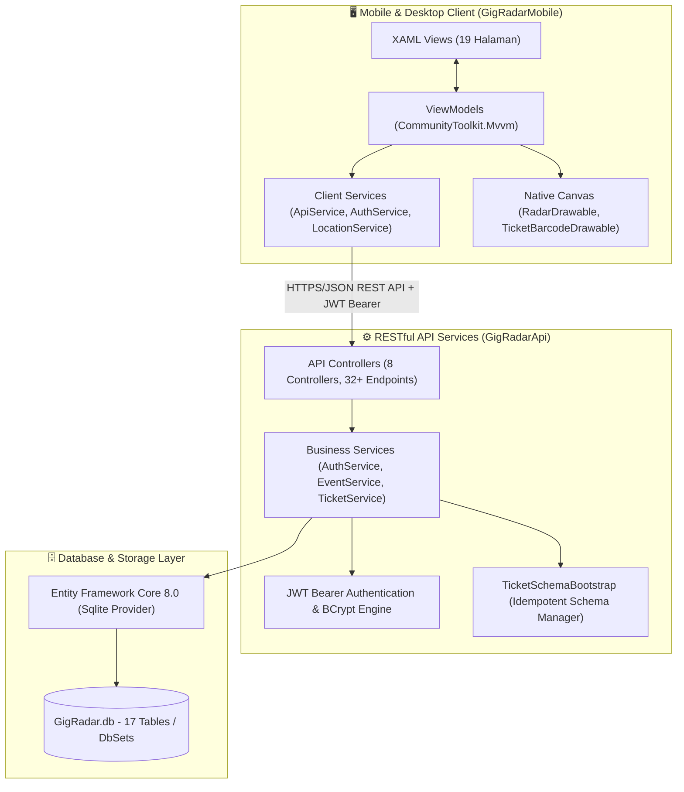
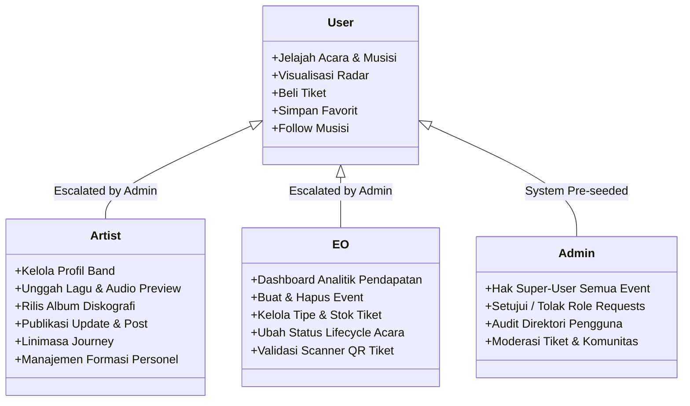
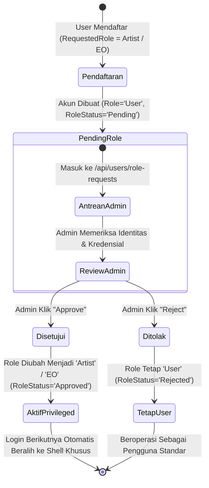
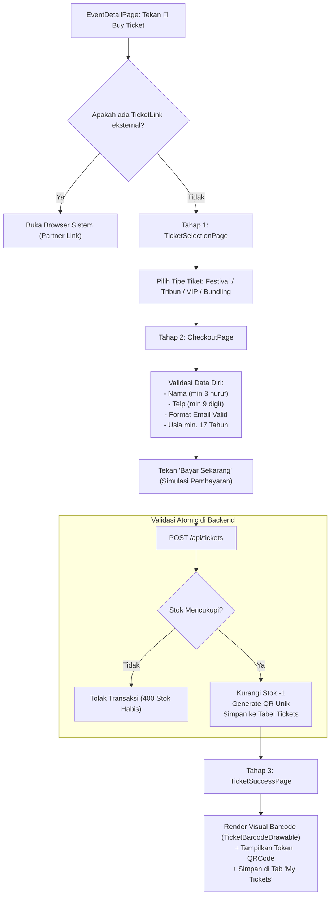
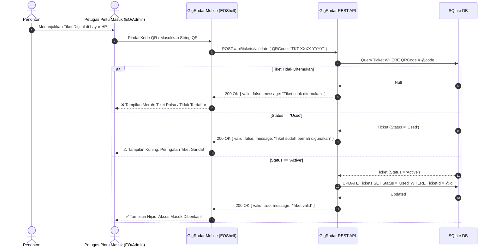
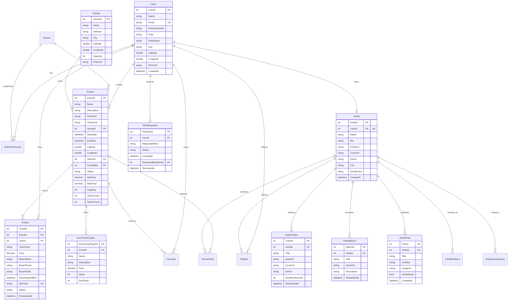
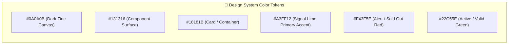

# 🌐 Gambaran Lengkap & Arsitektur Teknis Sistem — GigRadar
## *"Spesifikasi Teknis, Arsitektur Perangkat Lunak, dan Panduan Implementasi Komprehensif"*

---

## 1. Pendahuluan & Filosofi Arsitektur

**GigRadar** dirancang sebagai ekosistem digital modular dengan arsitektur **Client-Server** terdistribusi. Sistem ini memisahkan secara tegas antara lapisan antarmuka pengguna lintas platform (*Cross-Platform Native Presentation Layer*) dan lapisan layanan bisnis serta data (*Backend Services & Persistence Layer*).



### Prinsip Desain Rekayasa Perangkat Lunak:
1. **Separation of Concerns (SoC):** Aplikasi klien tidak memiliki akses langsung ke basis data. Seluruh transaksi wajib melalui REST API berstandar keamanan tinggi.
2. **Dynamic Role-Based Shell Routing:** Struktur navigasi antarmuka klien bermutasi secara dinamis sesuai klaim peran (*Role*) yang terverifikasi di token JWT.
3. **Stateless Backend:** Server API bersifat *stateless*; seluruh konteks identitas pengguna, hak akses, dan otorisasi dilewatkan melalui *Bearer Token* berenkripsi.
4. **Resilient & Idempotent Persistence:** Skema database diperbarui secara otomatis menggunakan teknik *idempotent SQL injection* melalui `TicketSchemaBootstrap`, menjaga keutuhan data lama saat versi sistem ditingkatkan.
5. **Privacy by Design:** Akses geolokasi native hanya aktif di *foreground* saat fitur spasial digunakan, tanpa pernah mencatat koordinat pengguna secara permanen di server.

---

## 2. Dekomposisi Komponen Proyek & Struktur File

Repositori GigRadar terbagi menjadi **3 komponen utama** yang saling mendukung:

```text
gigradar/
├── GigRadarApi/                 # Backend RESTful Web API (.NET 8)
│   ├── Program.cs               # WebHost builder, DI, CORS, JWT, Swagger setup, DB bootstrap
│   ├── appsettings.json         # Konfigurasi koneksi SQLite & JwtSettings
│   ├── GigRadar.db              # File SQLite database produksi & development
│   ├── Controllers/             # 8 REST Controller pengekspos endpoint
│   │   ├── ArtistController.cs  # Portal musisi (tracks, albums, posts, journey, members)
│   │   ├── ArtistsController.cs # Akses publik katalog musisi
│   │   ├── AuthController.cs    # Pendaftaran akun & verifikasi login
│   │   ├── EventsController.cs  # CRUD event, status lifecycle, nearby, tonight, weekend
│   │   ├── GenresController.cs  # Katalog genre musik & emoji icon
│   │   ├── TicketsController.cs # Pembelian, tipe tiket, validasi QR code
│   │   ├── UsersController.cs   # Profil, preferensi genre, favorites, follows, role-requests
│   │   └── VenuesController.cs  # Direktori venue & penambahan tempat baru
│   ├── Services/                # Lapisan logika bisnis (Business Logic Layer)
│   │   ├── AuthService.cs       # Hashing BCrypt, penerbitan JWT, approval role
│   │   ├── EventService.cs      # Algoritma Haversine, kuota tiket, proteksi IDOR
│   │   └── TicketService.cs     # Transaksi pembelian tiket atomik & validasi QR
│   ├── Data/                    # Lapisan akses data (Data Access Layer)
│   │   ├── AppDbContext.cs      # 17 DbSet, relasi relasional, indeks unik, seed data
│   │   └── TicketSchemaBootstrap.cs # Migrasi skema idempoten tanpa kehilangan data
│   └── Models/                  # POCO Entities & DTOs
│       ├── User.cs              # User, UserPreference, Follow, RoleRequest
│       ├── Artist.cs            # Artist, AudioTrack, ArtistAlbum, ArtistPost, Member, Journey
│       ├── Event.cs             # Event, EventArtist, EventTicketType, Favorite
│       ├── Ticket.cs            # Ticket data model
│       ├── Venue.cs             # Venue data model
│       └── Genre.cs             # Genre data model
│
├── GigRadarMobile/              # Aplikasi Klien Lintas Platform (.NET MAUI .NET 10)
│   ├── App.xaml / App.xaml.cs   # Entry point visual & inisialisasi Shell per role
│   ├── MauiProgram.cs           # Dependency Injection container, font registration, crash logger
│   ├── Shells/                  # Multi-Shell Dynamic Routing
│   │   ├── UserShell.xaml       # Navigasi tab User (Discover, Explore, Radar, Tickets, Profile)
│   │   ├── EOShell.xaml         # Navigasi tab EO (Dashboard, Events, Tickets, Analytics, Profile)
│   │   ├── ArtistShell.xaml     # Navigasi tab Artist (Dashboard, Profile)
│   │   ├── AdminShell.xaml      # Navigasi tab Admin (Dashboard, Events, Tickets, Users, Profile)
│   │   └── Routes.cs            # Pendaftaran rute navigasi modal global
│   ├── Views/                   # 19 Halaman UI XAML
│   │   ├── LoginPage.xaml, OnboardingPage.xaml, HomePage.xaml, EventDetailPage.xaml
│   │   ├── ExplorePage.xaml, RadarPage.xaml, TicketPage.xaml, ProfilePage.xaml
│   │   ├── TicketSelectionPage.xaml, CheckoutPage.xaml, TicketSuccessPage.xaml
│   │   ├── ArtistDetailPage.xaml, ArtistDashboardPage.xaml, EoProfilePage.xaml
│   │   ├── EoEventsPage.xaml, EoAnalyticsPage.xaml, CreateEventPage.xaml
│   │   ├── ManageTicketsPage.xaml, UsersPage.xaml
│   │   └── *.xaml.cs            # Code-behind (hanya menangani lifecycle UI, zero business logic)
│   ├── ViewModels/              # 18 ViewModels (CommunityToolkit.Mvvm)
│   ├── Services/                # Abstraksi REST & Device Sensors
│   │   ├── ApiService.cs        # Wrapper HTTP Client ke GigRadarApi
│   │   ├── AuthService.cs       # Manajemen sesi lokal via MAUI Preferences & klaim token
│   │   ├── LocationService.cs   # Geolokasi native, deteksi izin, dan fallback otomatis
│   │   └── ApiConfiguration.cs  # Resolusi base URL dinamis per platform (Android/Windows)
│   ├── Helpers/                 # Graphic Drawables & Utility Converters
│   │   ├── RadarDrawable.cs     # Mesin penggambaran radar polar native (GraphicsView)
│   │   ├── TicketBarcodeDrawable.cs # Generator visual barcode tiket
│   │   ├── GeoHelper.cs         # Perhitungan jarak Haversine & bantalan arah (bearing)
│   │   ├── ShellRouter.cs       # Factory pemilih shell berbasis role
│   │   └── CrashLogger.cs       # Penangkap stowed exception runtime
│   └── Resources/               # Aset Desain, Font (Space Grotesk, Inter), Warna & Gaya
│
├── GigRadarLauncher/            # Utilitas Otomasi Pengembang (.NET 8 Console)
│   └── Program.cs               # Menyalakan API pada port 5000 dan meluncurkan Swagger UI
│
├── docs/                        # Direktori Dokumentasi Proyek
│   ├── PRD.md                   # Product Requirement Document v2.0
│   ├── GAMBARAN_LENGKAP_APLIKASI.md # Dokumen Arsitektur Teknis Sistem (File ini)
│   ├── REKAPAN_APLIKASI.md      # Rekapan Ringkas & Status Implementasi
│   └── README.md                # Indeks Navigasi Dokumentasi
│
├── StartGigRadar.bat            # Shortcut Windows: Menyalakan API + Browser Swagger
└── StartMobileApp.bat           # Shortcut Windows: Build & Run Windows Native Desktop App
```

---

## 3. Sistem Multi-Role & Dynamic Shell Routing

### 3.1 Matriks Peran Pengguna (Role Architecture)
GigRadar menerapkan sistem satu aplikasi terpadu dengan 4 tingkat peran:



### 3.2 Siklus Hidup Permohonan Role (Role Request Workflow)
Pengguna umum dapat mengajukan peningkatan peran menjadi `Artist` atau `EO` saat pendaftaran. Alur ini diproteksi oleh mekanisme verifikasi Admin untuk mencegah promotor fiktif:



### 3.3 Dynamic Shell Routing Mechanism
Saat inisialisasi aplikasi di [`App.xaml.cs`](file:///C:/Users/aldii/gigradar/GigRadarMobile/App.xaml.cs), [`ShellRouter.CreateForRole()`](file:///C:/Users/aldii/gigradar/GigRadarMobile/Helpers/ShellRouter.cs) membaca token JWT yang tersimpan di `Preferences`. Jika token valid, shell yang sesuai langsung dimuat:

```csharp
public static Shell CreateForRole(string role)
{
    return role switch
    {
        "EO" => new Shells.EOShell(),
        "Admin" => new Shells.AdminShell(),
        "Artist" => new Shells.ArtistShell(),
        _ => new Shells.UserShell()
    };
}
```

---

## 4. Mesin Tiket Berjenjang & Siklus Validasi Gatekeeper

### 4.1 Alur Transaksi 3-Tahap
Sistem transaksi internal dirancang untuk menghilangkan friksi pengisian formulir manual yang kerap terjadi di skena independen:



### 4.2 Validasi Pintu Masuk (*Gate Entry QR Scanner*)
Pada hari pelaksanaan acara, kru EO atau Admin memvalidasi tiket pengunjung menggunakan endpoint `/api/tickets/validate`:



---

## 5. Location-Based Services (LBS) & Visualisasi Radar Spasial

### 5.1 Arsitektur Geolokasi Native (`LocationService.cs`)
Untuk menjaga performa dan menghormati privasi pengguna, pengaksesan sensor GPS diisolasi di dalam [`LocationService.cs`](file:///C:/Users/aldii/gigradar/GigRadarMobile/Services/LocationService.cs):
- **On-Demand Permission:** Dialog izin lokasi hanya muncul saat halaman `HomePage`, `ExplorePage`, atau `RadarPage` meminta titik koordinat pengguna.
- **Accuracy Target:** Menggunakan `GeolocationAccuracy.Medium` guna membatasi konsumsi daya baterai.
- **Timeout & Fallback:** Batas waktu pembacaan sensor adalah 5 detik. Jika GPS mati, timeout, atau izin ditolak, sistem beralih otomatis ke *fallback default* (Jakarta: Lat `-6.2088`, Lng `106.8456`).

### 5.2 Algoritma Spasial Haversine & Bearing
Jarak geografis antara pengguna $(lat_1, lon_1)$ dan venue acara $(lat_2, lon_2)$ dihitung dengan rumus Haversine bola bumi ($R = 6371 \text{ km}$):

$$\Delta lat = lat_2 - lat_1, \quad \Delta lon = lon_2 - lon_1$$
$$a = \sin^2\left(\frac{\Delta lat}{2}\right) + \cos(lat_1) \cdot \cos(lat_2) \cdot \sin^2\left(\frac{\Delta lon}{2}\right)$$
$$c = 2 \cdot \text{atan2}\left(\sqrt{a}, \sqrt{1-a}\right)$$
$$d = R \cdot c$$

Arah sudut (*bearing angle*) dihitung dengan rumus sudut azimut:
$$\theta = \text{atan2}\left(\sin(\Delta lon) \cdot \cos(lat_2), \cos(lat_1) \cdot \sin(lat_2) - \sin(lat_1) \cdot \cos(lat_2) \cdot \cos(\Delta lon)\right)$$

### 5.3 Rendering Proyeksi Radar Kanvas Native (`RadarDrawable.cs`)
Visualisasi radar memanfaatkan canvas vector 2D native .NET MAUI:
1. Kanvas menggambar lingkaran konsentris berjarak proporsional (mis. 5 km, 15 km, 30 km, 50 km).
2. Garis sweep hijau neon berotasi secara kontinu untuk mensimulasikan pemindaian frekuensi suara.
3. Koordinat kutub $(\text{jarak } d, \text{sudut } \theta)$ dari tiap gig dipetakan ke koordinat kartesius kanvas $(X, Y)$:

$$X = Center_X + \left(\frac{d}{\text{MaxRadius}} \cdot \text{CanvasRadius}\right) \cdot \sin(\theta)$$
$$Y = Center_Y - \left(\frac{d}{\text{MaxRadius}} \cdot \text{CanvasRadius}\right) \cdot \cos(\theta)$$

4. Setiap titik node diberi warna berpendar (*glowing effect*) sesuai palet genre musik event bersangkutan via [`GenreColors.cs`](file:///C:/Users/aldii/gigradar/GigRadarMobile/Helpers/GenreColors.cs).
5. Sentuhan pada koordinat kanvas mendeteksi titik terdekat dalam ambang batas toleransi sentuhan (*hit-testing radius* 24px) untuk memunculkan *Quick Preview Card*.

---

## 6. Skema Basis Data & Relasi Entitas (ERD)

Database SQLite dikelola oleh Entity Framework Core dengan **17 Entity Sets / DbSets**:



### 6.1 Idempotent Schema Upgrader (`TicketSchemaBootstrap.cs`)
Karena `EnsureCreated()` EF Core tidak melakukan mutasi skema jika file database `GigRadar.db` sudah terbentuk, kelas `TicketSchemaBootstrap` mengeksekusi pemeriksaan metadata tabel secara native saat runtime:
1. Mengecek kolom `TicketLink` di tabel `Events`. Bila belum ada, mengeksekusi `ALTER TABLE Events ADD COLUMN TicketLink TEXT...`.
2. Mengecek kolom `RoleStatus` di tabel `Users`.
3. Mengecek data diri pembeli (`BuyerName`, `BuyerPhone`, `BuyerEmail`, `BuyerDateOfBirth`) di tabel `Tickets`.
4. Membuat tabel `EventTicketTypes`, tabel-tabel ekosistem Artist (`ArtistAlbums`, `ArtistPosts`, `ArtistMembers`, `ArtistJourneyItems`), dan tabel `RoleRequests` dengan klausa `CREATE TABLE IF NOT EXISTS`.
5. Melakukan *idempotent seed injection* untuk akun demo EO (`eo@gigradar.com`), Admin (`admin@gigradar.com`), dan Artist (`artist@gigradar.com`), serta kategori tiket awal.

---

## 7. Katalog Spesifikasi REST API

Backend mengekspos **32+ Endpoint RESTful** yang dikelompokkan ke dalam 8 modul pengontrol:

### 7.1 Modul Auth (`AuthController.cs`)
| Method | Route | Otorisasi | Deskripsi & Payload |
| :--- | :--- | :--- | :--- |
| `POST` | `/api/auth/register` | Publik | Mendaftarkan pengguna baru. Body: `{ name, email, password, requestedRole }`. |
| `POST` | `/api/auth/login` | Publik | Verifikasi kredensial. Body: `{ email, password }`. Mengembalikan Token JWT & profil ringkas. |

### 7.2 Modul Events (`EventsController.cs`)
| Method | Route | Otorisasi | Deskripsi & Payload |
| :--- | :--- | :--- | :--- |
| `GET` | `/api/events` | Publik | Mengambil semua event aktif beserta venue, genre, dan lineup artis. |
| `GET` | `/api/events/{id}` | Publik | Mengambil data detail event spesifik beserta relasi lengkap. |
| `GET` | `/api/events/nearby` | Publik | Mengambil event dalam radius kilometer. Query: `?lat=&lng=&radius=50`. |
| `GET` | `/api/events/tonight` | Publik | Mengambil seluruh gig yang diselenggarakan hari ini. |
| `GET` | `/api/events/weekend` | Publik | Mengambil event dari hari Jumat hingga Minggu terdekat. |
| `GET` | `/api/events/recommended` | 🔒 Authenticated | Mengambil daftar rekomendasi berbasis preferensi genre pengguna. |
| `GET` | `/api/events/managed` | 🔒 EO, Admin | Mengambil event yang dikelola: Admin (semua), EO (hanya event miliknya). |
| `GET` | `/api/events/managed/summary`| 🔒 EO, Admin | Ringkasan statistik analitik: total event, tiket terjual, dan akumulasi omset. |
| `POST` | `/api/events` | 🔒 EO, Admin | Membuat event baru. Mengikat `CreatedBy` secara otomatis ke `UserId` pemanggil. |
| `PUT` | `/api/events/{id}` | 🔒 EO, Admin | Memperbarui event. Memverifikasi hak kepemilikan pemilik event (anti-IDOR). |
| `PUT` | `/api/events/{id}/status` | 🔒 EO, Admin | Mengubah status siklus event (`Published`, `Draft`, `SoldOut`, `Completed`). |
| `DELETE`| `/api/events/{id}` | 🔒 EO, Admin | Menghapus event beserta seluruh relasi tiket, favorit, dan line-up. |

### 7.3 Modul Tickets (`TicketsController.cs`)
| Method | Route | Otorisasi | Deskripsi & Payload |
| :--- | :--- | :--- | :--- |
| `GET` | `/api/tickets` | 🔒 Authenticated | Mengambil riwayat tiket milik pengguna yang sedang login. |
| `GET` | `/api/tickets/{id}` | 🔒 Authenticated | Mengambil rincian informasi dan status pemakaian tiket tunggal. |
| `GET` | `/api/tickets/event/{id}/types`| 🔒 Authenticated | Mengambil daftar kategori tiket per event (harga, sisa kuota stok). |
| `POST` | `/api/tickets` | 🔒 Authenticated | Membeli tiket: verifikasi usia $\ge 17$, nomor telepon, dan pengurangan stok atomik. |
| `POST` | `/api/tickets/validate` | 🔒 EO, Admin | Memvalidasi QR code penonton di gate entry dan mengubah status menjadi `Used`. |
| `POST` | `/api/tickets/event/{id}/types`| 🔒 EO, Admin | Menambahkan kategori tiket baru untuk event yang dimiliki EO. |
| `PUT` | `/api/tickets/types/{typeId}` | 🔒 EO, Admin | Memperbarui nama, deskripsi, harga, atau kuota tipe tiket. |
| `DELETE`| `/api/tickets/types/{typeId}` | 🔒 EO, Admin | Menghapus tipe tiket tertentu. |

### 7.4 Modul Portal Musisi (`ArtistController.cs`)
| Method | Route | Otorisasi | Deskripsi & Payload |
| :--- | :--- | :--- | :--- |
| `GET` | `/api/artist/me` | 🔒 Artist | Mengambil profil artist pengguna yang sedang login beserta anggota & statistik. |
| `PUT` | `/api/artist/me` | 🔒 Artist | Memperbarui data profil musisi (bio, cover, kota, tautan sosial). |
| `GET` | `/api/artist/me/dashboard` | 🔒 Artist | Mengambil ringkasan dashboard artist (followers, trek, album, gigs mendatang). |
| `POST` | `/api/artist/tracks` | 🔒 Artist | Menambahkan rekaman lagu baru beserta durasi preview audio. |
| `PUT` | `/api/artist/tracks/{id}` | 🔒 Artist | Memperbarui data trek audio. |
| `DELETE`| `/api/artist/tracks/{id}` | 🔒 Artist | Menghapus trek audio milik musisi. |
| `POST` | `/api/artist/albums` | 🔒 Artist | Merilis album atau EP musik baru ke dalam katalog. |
| `PUT` | `/api/artist/albums/{id}` | 🔒 Artist | Memperbarui metadata album. |
| `DELETE`| `/api/artist/albums/{id}` | 🔒 Artist | Menghapus album dari katalog musisi. |
| `POST` | `/api/artist/posts` | 🔒 Artist | Mempublikasikan update berita, info merchandise, atau catatan band. |
| `PUT` | `/api/artist/posts/{id}` | 🔒 Artist | Memperbarui postingan berita. |
| `DELETE`| `/api/artist/posts/{id}` | 🔒 Artist | Menghapus postingan berita. |
| `POST` | `/api/artist/journey` | 🔒 Artist | Menambahkan tonggak pencapaian karir band (*milestones*). |
| `DELETE`| `/api/artist/journey/{id}` | 🔒 Artist | Menghapus tonggak pencapaian karir band. |
| `POST` | `/api/artist/members` | 🔒 Artist | Menambahkan profil personel anggota band. |
| `DELETE`| `/api/artist/members/{id}` | 🔒 Artist | Menghapus personel anggota band. |

### 7.5 Modul Users & Admin Backoffice (`UsersController.cs`)
| Method | Route | Otorisasi | Deskripsi & Payload |
| :--- | :--- | :--- | :--- |
| `GET` | `/api/users` | 🔒 Admin | Mengambil direktori seluruh pengguna terdaftar untuk audit administrasi. |
| `GET` | `/api/users/me` | 🔒 Authenticated | Mengambil data profil pengguna yang login beserta preferensi genre musik. |
| `PUT` | `/api/users/me` | 🔒 Authenticated | Memperbarui nama lengkap, kota domisili, atau URL foto profil. |
| `POST` | `/api/users/preferences` | 🔒 Authenticated | Menyimpan preferensi genre musik (menggantikan array sebelumnya). |
| `POST` | `/api/users/favorites/{eventId}`| 🔒 Authenticated | Toggle simpan/hapus event dari daftar favorit pengguna. |
| `GET` | `/api/users/favorites` | 🔒 Authenticated | Mengambil koleksi event yang disimpan oleh pengguna. |
| `GET` | `/api/users/follows` | 🔒 Authenticated | Mengambil daftar musisi yang diikuti oleh pengguna. |
| `POST` | `/api/users/follows/{artistId}`| 🔒 Authenticated | Mengikuti musisi lokal (idempoten). |
| `DELETE`| `/api/users/follows/{artistId}`| 🔒 Authenticated | Berhenti mengikuti musisi lokal. |
| `GET` | `/api/users/role-requests` | 🔒 Admin | Mengambil daftar antrean permohonan kenaikan role pengguna (`Pending`). |
| `POST` | `/api/users/role-requests/{id}/approve` | 🔒 Admin | Menyetujui permohonan role dan menaikkan hak akses pengguna menjadi EO/Artist. |
| `POST` | `/api/users/role-requests/{id}/reject` | 🔒 Admin | Menolak permohonan role (pengguna tetap berstatus User reguler). |

---

## 8. Panduan Desain & Spesifikasi Token Antarmuka

Mengacu pada `GIGRADAR_DESIGN_SYSTEM.md`, identitas visual GigRadar dibangun di atas estetika *zinc dark* industrial dengan aksen *signal lime* tajam:



### 8.1 Spesifikasi Tipografi
- **Display & Headings:** `Space Grotesk` (Bold / Semi-Bold) — memberikan karakter geometris tegas, modular, dan lekat dengan identitas poster gigs independen.
- **Body & Captions:** `Inter` (Regular / Medium) — menjamin tingkat keterbacaan optimal (*legibility*) pada layar mobile beresolusi tinggi maupun rendah.
- **Eyebrow Text:** Huruf kapital penuh (*uppercase*) dengan *letter spacing* renggang untuk menandai kategori, genre, atau tanggal acara.

### 8.2 Tanggung Jawab Penanganan Stowed Crash (`CrashLogger.cs`)
Untuk mencegah *silent crash* pada target Windows Native saat terjadi stowed exception di runtime XAML WinUI 3, kelas [`CrashLogger.cs`](file:///C:/Users/aldii/gigradar/GigRadarMobile/Helpers/CrashLogger.cs) dipasang di `MauiProgram.cs` untuk menangkap `AppDomain.CurrentDomain.UnhandledException` dan `TaskScheduler.UnobservedTaskException`, mencatat jejak stacktrace ke direktori lokal aplikasi.

---

## 9. Petunjuk Kompilasi, Build & Menjalankan Proyek

### 9.1 Prasyarat Perangkat Lunak
- **.NET SDK 8.0:** Diperlukan untuk kompilasi backend `GigRadarApi` dan `GigRadarLauncher`.
- **.NET SDK 10.0:** Dengan workload **`maui`** terpasang (`dotnet workload install maui`).
- **Visual Studio 2022 (v17.10+)** atau **VS Code** dengan ekstensi *C# Dev Kit* dan *.NET MAUI*.

### 9.2 Menjalankan Backend API & Swagger UI
Eksekusi shortcut batch Windows:
```bash
./StartGigRadar.bat
```
Atau via terminal CLI:
```bash
dotnet run --project GigRadarApi/GigRadarApi.csproj --urls http://localhost:5000
```
*Dokumentasi interaktif OpenAPI Swagger tersedia di:* `http://localhost:5000/swagger`

### 9.3 Menjalankan Aplikasi Klien (.NET MAUI)

#### A. Target Windows Native Desktop (Cara Tercepat)
Eksekusi shortcut:
```bash
./StartMobileApp.bat
```
Atau manual via terminal:
```bash
dotnet build GigRadarMobile/GigRadarMobile.csproj -f net10.0-windows10.0.19041.0 -c Debug
# Jalankan biner eksekutabel di folder:
# GigRadarMobile/bin/Debug/net10.0-windows10.0.19041.0/win-x64/GigRadarMobile.exe
```

#### B. Target Android Emulator / Device
```bash
# Pastikan perangkat/emulator terhubung
adb devices

# Build dan deploy ke perangkat Android
dotnet build GigRadarMobile/GigRadarMobile.csproj -f net10.0-android -t:Run
```
*Catatan Android:* `ApiConfiguration.cs` secara otomatis menggunakan `http://10.0.2.2:5000` saat berjalan di emulator Android untuk merutekan traffic ke localhost mesin host.

#### C. Target iOS & Mac Catalyst (Memerlukan macOS)
```bash
dotnet build GigRadarMobile/GigRadarMobile.csproj -f net10.0-maccatalyst -t:Run
dotnet build GigRadarMobile/GigRadarMobile.csproj -f net10.0-ios -t:Run
```

### 9.4 Akun Pengujian Bawaan (*Seeded Demo Credentials*)
Basis data otomatis menyertakan akun siap pakai untuk mempermudah demonstrasi dan audit fitur:

| Peran | Alamat Email | Kata Sandi | Cakupan Pengujian |
| :--- | :--- | :--- | :--- |
| **`Admin`** | `admin@gigradar.com` | `admin123` | Akses `AdminShell`, audit daftar pengguna, persetujuan/penolakan `RoleRequests`, moderasi seluruh event. |
| **`EO`** | `eo@gigradar.com` | `eo123` | Akses `EOShell`, dashboard analitik omset, buat event baru, kelola kuota tipe tiket, validasi QR tiket. |
| **`Artist`** | `artist@gigradar.com` | `artist123` | Akses `ArtistShell`, dashboard statistik band (Hollow Men), kelola trek, rilis album, band journey, update postingan. |
| **`User`** | *(Registrasi langsung di app)* | — | Akses `UserShell`, onboarding genre, visual radar, beli tiket internal, barcode visual, favorit & follow. |

---
*Dokumen arsitektur ini merupakan cetak biru resmi teknis sistem GigRadar. Setiap penambahan modul atau refaktorisasi wajib mempertahankan integritas konvensi yang tercantum di sini.*
