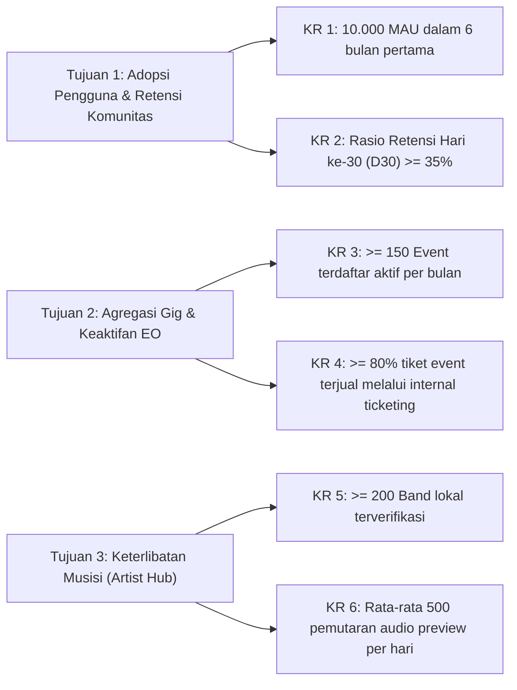
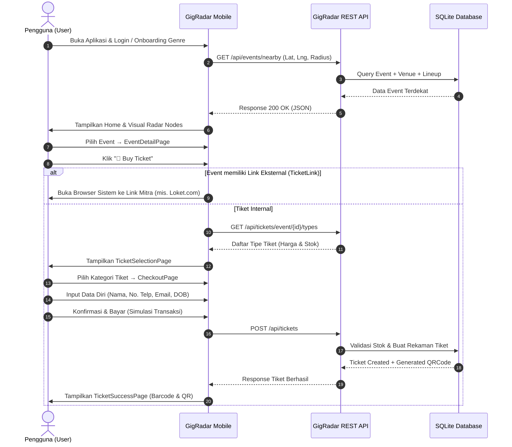
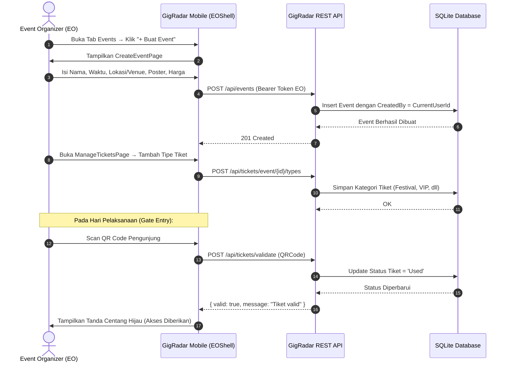
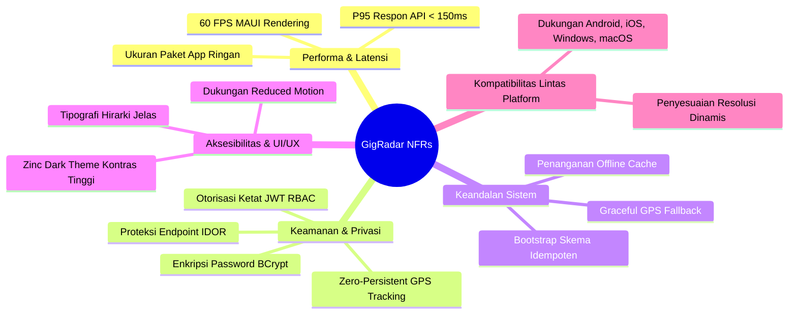
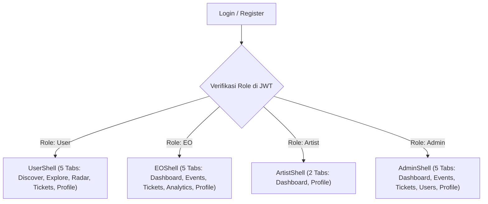
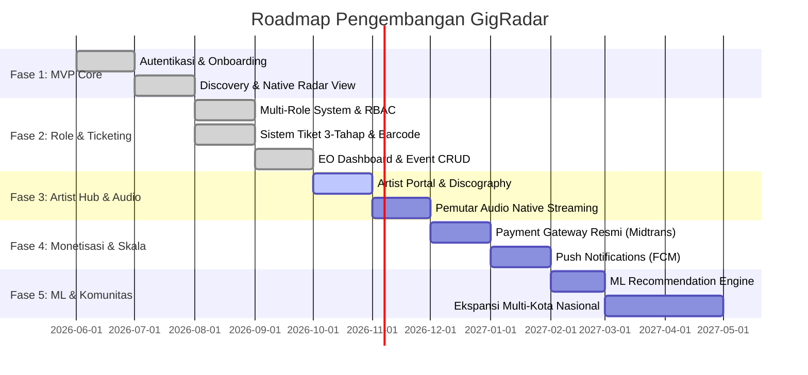

# 📄 Product Requirement Document (PRD) — GigRadar
## *"Menghubungkan Skena, Menemukan Suara Lokal"*

---

## 📌 Metadata Dokumen

| Properti | Keterangan |
| :--- | :--- |
| **Nama Produk** | **GigRadar** |
| **Versi Dokumen** | v2.0 (Comprehensive Multi-Role & Ticketing Edition) |
| **Status** | Production Ready / Active Development |
| **Tanggal Pembaruan** | Oktober 2026 |
| **Klasifikasi** | Internal Engineering, Design & Product Specification |
| **Target Platform** | Mobile & Desktop (.NET MAUI: Android, iOS, Windows, macOS) |
| **Target Backend** | Cloud REST API (ASP.NET Core Web API .NET 8 + SQLite) |

---

## 1. Executive Summary & Product Vision

### 1.1 Latar Belakang & Problem Statement
Skena musik lokal, independen, underground, serta showcase komunitas memiliki ekosistem yang dinamis dan berakar kuat di berbagai kota. Namun, hingga saat ini terdapat kesenjangan signifikan (*market friction*) yang dihadapi oleh para pelaku skena:
1. **Bagi Penikmat Musik (Audience):** Sulit menemukan konser mikro, gigs kafe/gudang, atau pertunjukan underground yang berada di sekitar tempat tinggal mereka. Informasi konser sering kali tersebar di puluhan poster media sosial tanpa struktur waktu, lokasi akurat, atau katalog audio pengenal musisi.
2. **Bagi Musisi & Band Independen (Artists):** Musisi lokal minim memiliki wadah terpadu untuk memperkenalkan rilisan lagu, menampilkan perjalanan karir (*band journey*), merilis showcase, dan membangun basis penggemar (*grassroots fan base*) secara organik di kota mereka.
3. **Bagi Event Organizer Lokal (EO):** Mengelola penjualan tiket mandiri sering terbentur biaya platform besar yang mahal atau kerumitan sistem manual (via spreadsheet / transfer perbankan tanpa validasi barcode instan), serta minimnya sarana menjangkau audiens tertarget berdasarkan preferensi genre.
4. **Bagi Ekosistem Skena:** Ketiadaan jembatan digital berbasis lokasi (*Location-Based Services*) yang intuitif yang mampu memetakan ekosistem gig secara *real-time*.

### 1.2 Visi Produk
> **GigRadar** hadir sebagai platform terintegrasi pertama yang menghubungkan penikmat musik independen dengan pertunjukan lokal, showcase underground, dan festival komunitas melalui kekuatan **Location-Based Service (LBS)**, **visualisasi radar interaktif**, **personalisasi genre**, **sistem tiket berjenjang mandiri**, dan **ruang kolaborasi multi-role** (Audience, Musisi, Promotor, dan Administrator).

### 1.3 Nilai Inti (*Core Value Propositions*)
- **Hyper-Local Discovery:** Temukan gig terdekat dalam hitungan detik berdasarkan posisi pengguna via GPS atau radius kota.
- **Interactive Radar Engine:** Visualisasi spasial unik yang memproyeksikan acara musik layaknya detektor radar frekuensi audio.
- **Sistem Tiket Terpadu 3-Tahap:** Pembelian tiket internal dengan alokasi stok berjenjang (Festival, VIP, Bundling Merchandise) serta validasi kode QR cepat di pintu masuk (*gate entry*).
- **Ekosistem Multi-Role yang Disesuaikan:** Satu akun terpadu dengan antarmuka dinamis (*Dynamic Shell*) yang bertransformasi sesuai peran: User, EO, Artist, atau Admin.
- **Indie Aesthetic Identity:** Pengalaman visual dark-zinc modern bertaraf editorial dengan kontras tinggi Signal Lime yang merefleksikan etos skena alternatif.

---

## 2. Strategic Objectives & Success Metrics (KPIs / OKRs)

### Key Performance Indicators (KPIs):
- **User Engagement:** Durasi sesi rata-rata > 4 menit per kunjungan; tingkat penggunaan fitur Radar Spasial > 60% dari seluruh pengguna aktif.
- **Transaction Conversion Rate:** Persentase pengguna yang membuka `EventDetailPage` hingga menyelesaikan `CheckoutPage` mencapai minimal 8.5%.
- **Validation Speed:** Waktu rata-rata pemindaian kode QR di pintu masuk < 1.5 detik per tiket.
- **API Latency:** P95 response time seluruh endpoint backend di bawah 150 ms pada beban normal.

---

## 3. Target User Personas & Empathy Map

### 3.1 Persona 1: Rizky — Penikmat Musik Indie & Showcase Hunter (Role: `User`)
- **Demografi:** 22 tahun, Mahasiswa / Kreator Konten, Jakarta Selatan.
- **Perilaku:** Gemar mendengarkan shoegaze, indie pop, dan alternative rock; rutin mencari gigs intim di akhir pekan bersama teman komunitas.
- **Pain Points:** Sering terlambat mengetahui gigs musisi favorit di kafe lokal karena info hanya diunggah lewat Instagram story yang hilang dalam 24 jam; malas membeli tiket lewat Google Form manual.
- **Kebutuhan di GigRadar:** Filter gigs "Malam Ini" (*Tonight*) dan "Akhir Pekan" (*Weekend*), visualisasi radar jarak, cuplikan lagu 30 detik untuk kenalan dengan line-up baru, serta tiket digital dengan barcode offline.

### 3.2 Persona 2: Bayu — Promotor Kolektif & Event Organizer (Role: `EO`)
- **Demografi:** 28 tahun, Pendiri Kolektif Gigs Mandiri, Bandung.
- **Perilaku:** Menyelenggarakan showcase bulanan berkapasitas 100–400 penonton di artspace/kedai kopi.
- **Pain Points:** Platform ticketing komersial membebankan potongan komisi besar dan proses pencairan berbelit-belit; sulit melacak siapa saja yang sudah masuk venue saat malam pertunjukan.
- **Kebutuhan di GigRadar:** Formulir pembuatan event kilat, pembuatan kategori tiket bertingkat (Early Bird, Presale, On The Spot, Bundling Kaos), dashboard pendapatan *real-time*, dan scanner QR validasi tiket di pintu masuk.

### 3.3 Persona 3: Hollow Men / Danu — Vokalis & Leader Band Indie (Role: `Artist`)
- **Demografi:** 25 tahun, Musisi Independen, Jakarta.
- **Perilaku:** Aktif merilis single mandiri, latihan rutin di studio, mencari panggung showcase lokal untuk memperluas basis pendengar.
- **Pain Points:** Algoritma streaming global terlalu luas dan menenggelamkan karya lokal; tidak punya tempat membagikan profil lengkap, jadwal gigs mendatang, dan kronologi pencapaian band.
- **Kebutuhan di GigRadar:** Profil band terverifikasi, kemampuan unggah daftar lagu & preview audio, katalog diskografi album, timeline linimasa perjalanan band (*Band Journey*), serta daftar event di mana band mereka masuk sebagai line-up resmi.

### 3.4 Persona 4: Sarah — Platform Operator & Moderator (Role: `Admin`)
- **Demografi:** 30 tahun, Head of Community & Content Operations GigRadar.
- **Perilaku:** Mengawasi kepatuhan konten, memverifikasi identitas promotor dan musisi, serta memoderasi event publik.
- **Pain Points:** Terjadinya spam akun promotor palsu atau event fiktif tanpa kurasi; kesulitan memantau metrik ekosistem secara agregat.
- **Kebutuhan di GigRadar:** Halaman persetujuan permohonan role (`Role Requests Approval`), kontrol penuh hapus/edit seluruh event, dan direktori master pengguna.

---

## 4. End-to-End User Experience & Flow Diagrams

### 4.1 Alur Pengalaman Penemuan Acara & Transaksi Tiket (User Journey)

### 4.2 Alur Tata Kelola Event & Validasi Tiket oleh EO

---

## 5. Functional Requirements (FR)

### Modul FR-1: Autentikasi, Akun & Keamanan Multi-Role
- **FR-1.1 Pendaftaran Terbuka:** Pengguna dapat mendaftar dengan Nama, Email, Password, dan mengajukan role yang diminati (`User`, `Artist`, atau `EO`).
- **FR-1.2 Role Escalation Workflow:** Pendaftaran dengan role `Artist` atau `EO` secara otomatis menghasilkan status permohonan `Pending` pada tabel `RoleRequests`. Selama belum disetujui Admin, akun beroperasi di bawah hak akses dasar `User`.
- **FR-1.3 Otorisasi JWT Berstandar:** Setiap login menghasilkan token JWT terenkripsi dengan masa kedaluwarsa 24 jam (1440 menit) yang menyimpan klaim: `UserId`, `Name`, `Email`, `Role`, dan `RoleStatus`.
- **FR-1.4 Keamanan Password:** Seluruh kata sandi wajib di-hash menggunakan algoritma **BCrypt** sebelum disimpan di basis data.

### Modul FR-2: Onboarding & Personalisasi Preferensi
- **FR-2.1 Katalog 12 Genre Utama:** Sistem menyediakan pilihan genre: Indie, Alternative, Rock, Punk, Hardcore, Shoegaze, Emo, Metal, Jazz, Folk, Electronic, dan Pop.
- **FR-2.2 Setup Onboarding:** Pengguna baru wajib memilih minimal satu genre favorit pada `OnboardingPage` sebelum mengakses `UserShell`.
- **FR-2.3 Bobot Preferensi:** Pilihan genre disimpan ke `UserPreferences` dengan pembobotan nilai untuk mendukung algoritma rekomendasi berjenjang.

### Modul FR-3: Discovery & Location-Based Services (LBS)
- **FR-3.1 Deteksi Geolokasi Native:** Aplikasi meminta izin lokasi perangkat (*foreground geolocation*) secara dinamis hanya saat mengakses fitur berbasis peta atau radar.
- **FR-3.2 Fallback Koordinat:** Jika sensor GPS nonaktif atau izin ditolak pengguna, sistem secara elegan menggunakan koordinat default (mis. Pusat Kota Jakarta: `-6.2088, 106.8456`) tanpa memicu crash.
- **FR-3.3 Algoritma Jarak Spasial:** Perhitungan jarak antara lokasi perangkat pengguna dan lokasi venue acara dihitung menggunakan rumus **Haversine** murni di backend dan helper mobile (`GeoHelper.cs`).
- **FR-3.4 Segmentasi Waktu:** Menyediakan tab penemuan instan:
  - *Nearby Gigs:* Acara terdekat dalam radius filter (10 km s/d 100 km).
  - *Tonight:* Seluruh pertunjukan yang berlangsung pada hari ini.
  - *Weekend:* Pertunjukan yang berlangsung dari Jumat hingga Minggu terdekat.
  - *Recommended:* Rekomendasi terpersonalisasi yang mencocokkan riwayat preferensi genre pengguna.

### Modul FR-4: Visualisasi Radar Interaktif (Interactive Radar)
- **FR-4.1 Rendering Kanvas Spasial:** Menggunakan `GraphicsView` dan `RadarDrawable` native untuk merender kanvas lingkaran polar dengan garis sweep radar bergerak.
- **FR-4.2 Pemetaan Node Dinamis:** Setiap event di sekitar direpresentasikan sebagai titik (node) yang dikodekan warnanya berdasarkan genre utama event tersebut.
- **FR-4.3 Interaktivitas Node:** Mengetuk titik event pada kanvas membuka kartu pratinjau ringkas (*Quick Preview Card*) yang mencakup poster, nama acara, venue, dan tombol langsung menuju `EventDetailPage`.

### Modul FR-5: Mesin Tiket Berjenjang & Validasi Transaksi
- **FR-5.1 Manajemen Kategori Tiket:** Setiap event dapat memiliki beberapa kategori tiket dengan konfigurasi: Nama Kategori, Deskripsi, Harga (IDR), Alokasi Stok, dan Urutan Tampilan (*SortOrder*).
- **FR-5.2 Integritas Transaksi & Pengurangan Stok:** Sistem melakukan validasi ketersediaan kuota secara atomik saat pemesanan. Stok yang bernilai 0 ditandai otomatis sebagai `SOLD OUT` dan dinonaktifkan dari pilihan pembelian.
- **FR-5.3 Validasi Identitas Pembeli:** Form checkout mewajibkan input identitas: Nama Lengkap (min. 3 karakter), Nomor Telepon (min. 9 digit), Format Email Valid, dan Usia Minimal 17 tahun (berdasarkan tanggal lahir).
- **FR-5.4 Barcode Visual & Unik QR Code:** Setelah pembayaran berhasil, sistem mencatat transaksi dan menghasilkan kode QR berformat acak terenkripsi (`TKT-{GUID}-{TIMESTAMP}`) serta barcode grafis untuk ditampilkan di `TicketSuccessPage` dan `TicketPage`.
- **FR-5.5 Validasi Pintu Masuk (*Gatekeeper Scanner*):** Endpoint `POST /api/tickets/validate` memungkinkan EO dan Admin memverifikasi QR code penonton. Tiket valid yang belum dipakai langsung diubah statusnya menjadi `Used`. Upaya pemindaian ulang tiket yang sama akan ditolak dengan notifikasi *"Tiket sudah pernah digunakan"*.

### Modul FR-6: Portal Manajemen Promotor & EO
- **FR-6.1 Dashboard Metrik Usaha:** Menampilkan ringkasan analitik real-time yang mencakup: Total Event Dikelola, Event Mendatang, Total Tiket Terjual, dan Akumulasi Pendapatan Kotor (GMV).
- **FR-6.2 Siklus Hidup Event (*Lifecycle Status*):** Promotor dapat mengontrol status event menjadi `Published`, `Draft`, `SoldOut`, atau `Completed`.
- **FR-6.3 CRUD Event Berkeamanan:** Promotor memiliki hak penuh menambah, menyunting, atau menghapus event miliknya. Sistem backend memverifikasi secara ketat bahwa `CreatedBy` sesuai dengan `UserId` dari token penyerang (mencegah *IDOR attack*).
- **FR-6.4 Venue Directory & Custom Venue:** EO dapat memilih venue yang sudah terdaftar atau mendaftarkan venue baru secara langsung saat pembuatan event.

### Modul FR-7: Artist Hub & Showcase Portal
- **FR-7.1 Profil Musisi Lengkap:** Menampilkan foto profil, sampul band (*cover art*), bio musisi, genre, kota asal, tautan media sosial, serta jumlah pengikut (*followers count*).
- **FR-7.2 Audio Preview & Discography:** Musisi dapat mengunggah katalog trek lagu (dengan cuplikan audio 30 detik) dan mengelompokkannya ke dalam album rilis resmi.
- **FR-7.3 Band Updates & Community Posts:** Fitur pengumuman resmi dan artikel blog singkat dari musisi untuk mengabarkan jadwal rilis, cuplikan latihan, atau merchandise baru.
- **FR-7.4 Band Journey Milestones:** Linimasa interaktif yang mencatat tonggak sejarah karir band (contoh: Pembentukan Band, Single Perdana, Tur Luar Kota, Nominasi Musik).
- **FR-7.5 Manajemen Formasi Anggota (*Band Line-up*):** Daftar anggota musisi dengan nama lengkap, instrumen/peran, foto, dan tahun bergabung.

### Modul FR-8: Interaksi Sosial & Komunitas
- **FR-8.1 Favorit & Wishlist Acara:** Pengguna dapat menekan ikon hati (*Save Event*) untuk menyimpan event ke dalam daftar `Favorites` yang dapat diakses di profil pribadi.
- **FR-8.2 Follow Musisi:** Pengguna dapat mengikuti musisi lokal favorit guna memantau gigs mendatang mereka di tab khusus.

### Modul FR-9: Konsol Administrasi & Moderasi Platform
- **FR-9.1 Moderasi Role Pengguna:** Admin dapat meninjau seluruh daftar antrean permohonan role (`Pending`), membaca email pemohon, serta mengeksekusi aksi `Approve` atau `Reject`.
- **FR-9.2 Direktori Global Pengguna:** Menampilkan seluruh akun terdaftar beserta role, status verifikasi, kota asal, dan tanggal registrasi.
- **FR-9.3 Hak Akses Super-Admin:** Admin memiliki wewenang untuk menyunting atau menghapus seluruh event tanpa batasan kepemilikan guna menjaga kepatuhan hukum dan komunitas.

---

## 6. Non-Functional Requirements (NFR)

### 6.1 Performa & Kecepatan Respons (Performance)
- **API Latency:** Seluruh request GET (Nearby, Tonight, Detail) harus mengembalikan respons dalam waktu < 200 ms pada koneksi 4G LTE standar.
- **UI Smoothness:** Antarmuka mobile .NET MAUI wajib mempertahankan kecepatan render 60 FPS pada animasi sweep radar dan scrolling daftar event berukuran panjang (memanfaatkan `CollectionView` recycling).
- **Memory Footprint:** Konsumsi RAM aplikasi mobile di Windows dan Android tidak boleh melebihi 180 MB saat kondisi standby.

### 6.2 Keamanan & Privasi Data (Security & Privacy)
- **Kerahasiaan Kredensial:** Kata sandi pengguna tidak boleh pernah disimpan atau dikirimkan dalam bentuk teks biasa (*plain text*).
- **Prinsip Lokasi Minimal (Privacy by Design):** Sistem dilarang meminta izin lokasi latar belakang (*Background Location*). Koordinat GPS hanya dibaca saat pengguna membuka tab navigasi yang membutuhkan pemetaan, dan dilarang disimpan secara permanen di database tanpa persetujuan eksplisit.
- **Validasi Otorisasi (Anti-Tampering):** Setiap aksi mutasi data (`POST`, `PUT`, `DELETE`) pada event atau tipe tiket wajib memverifikasi kecocokan `UserId` pemanggil terhadap pemilik sah sumber daya tersebut.

### 6.3 Keandalan & Ketersediaan (Reliability)
- **Idempotency Setup Database:** Inisialisasi basis data dan penambahan kolom baru via `TicketSchemaBootstrap` harus bersifat idempoten tanpa pernah merusak atau menghapus data yang telah tersimpan.
- **Crash Immunity:** Setiap pengecualian runtime yang tidak tertangani wajib ditangkap oleh `CrashLogger` native dan dicatat ke dalam log diagnostik tanpa menyebabkan aplikasi keluar paksa (*force close*) secara mendadak.

### 6.4 Desain & Aksesibilitas (UI/UX & Accessibility)
- **Palet Tema Zinc Dark:** Mengikuti standar `GIGRADAR_DESIGN_SYSTEM.md` dengan kontras rasio minimal 4.5:1 untuk teks biasa dan 3:1 untuk teks berukuran besar (WCAG 2.1 AA).
- **Reduced Motion Awareness:** Animasi radar dan transisi otomatis dinonaktifkan jika sistem operasi mendeteksi pengaturan aksesibilitas *Reduce Motion* aktif pada perangkat pengguna.

---

## 7. Dynamic Shell & Navigasi Per-Role

Aplikasi GigRadar mengimplementasikan arsitektur navigasi multi-cangkang (*Dynamic Shell Routing*) di mana struktur tab bawah (*bottom navigation*) beradaptasi secara otomatis begitu token JWT berhasil diverifikasi:

| Role | Nama Shell | Daftar Tab Navigasi Utama |
| :--- | :--- | :--- |
| **`User`** | `UserShell` | 1. Discover (Home) 2. Explore (Cari & Filter) 3. Radar (Spasial Nodes) 4. My Tickets (Tiket Saya) 5. Profile (Profil Pengguna) |
| **`EO`** | `EOShell` | 1. Dashboard (Statistik Ringkas) 2. Events (Koleksi Event Kelolaan) 3. Tickets (Manajemen Tipe Tiket & Kuota) 4. Analytics (Laporan Penjualan & Pendapatan) 5. Profile (Profil Akun & Pengaturan) |
| **`Artist`** | `ArtistShell` | 1. Dashboard (Statistik Band, Trek, Followers, Gigs Mendatang) 2. Profile (Profil Akun & Log Out) |
| **`Admin`** | `AdminShell` | 1. Dashboard (Monitoring Platform) 2. Events (Moderasi Seluruh Event) 3. Tickets (Pengawasan Penjualan Tiket) 4. Users (Verifikasi Role & Audit Pengguna) 5. Profile (Profil Administrator) |

---

## 8. Release Roadmap & Product Phases

---
*Dokumen ini dirancang sebagai acuan resmi pengembang, desainer, dan stakeholder dalam merancang, mengevaluasi, dan memperluas ekosistem GigRadar.*
