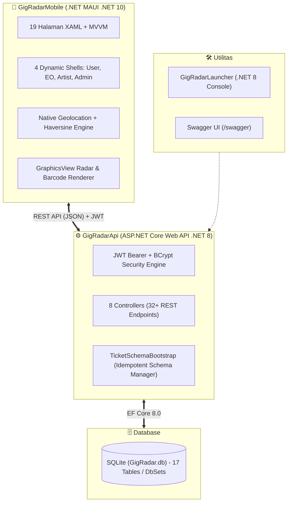
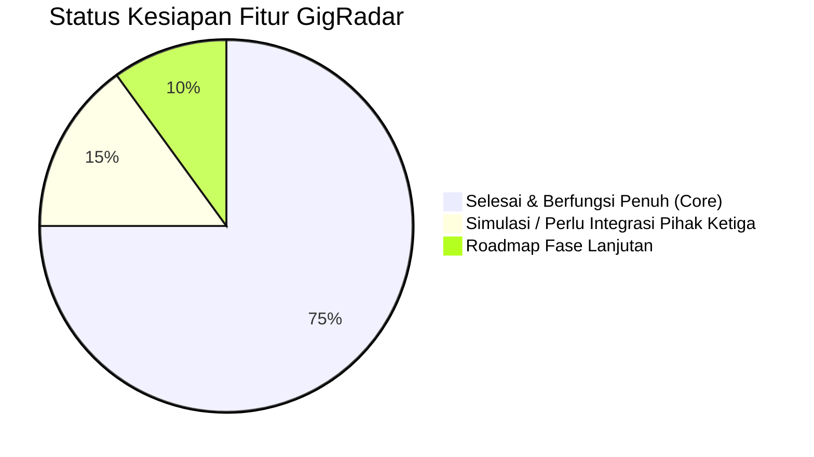

# 📊 Rekapan Lengkap Aplikasi — GigRadar
## *"Menghubungkan Skena, Menemukan Suara Lokal"*

---

## 1. Ringkasan Eksekutif (Executive Summary)

**GigRadar** adalah ekosistem aplikasi mobile dan desktop modern yang dirancang khusus untuk memetakan dan menghidupkan skena musik independen, pertunjukan underground, gigs intim di kedai/kafe lokal, showcase komunitas, hingga festival musik mandiri. 

Dengan memadukan teknologi **Location-Based Service (LBS)**, **visualisasi radar spasial interaktif**, **sistem tiket berjenjang 3-tahap mandiri**, dan **arsitektur antarmuka dinamis (*Dynamic Multi-Role Shell*)**, GigRadar menjadi platform terintegrasi yang menjembatani 4 pemangku kepentingan utama: Penikmat Musik (*Audience*), Musisi Independen (*Artists*), Promotor/Penyelenggara (*Event Organizers*), dan Pengelola Sistem (*Administrators*).

---

## 2. Ringkasan Arsitektur & Teknologi



| Komponen | Framework / Teknologi | Bahasa Pemrograman | Target Platform | Peran Utama |
| :--- | :--- | :--- | :--- | :--- |
| **`GigRadarApi`** | ASP.NET Core Web API (.NET 8) | C# 12 | Cross-Platform (`net8.0`) | Backend layanan RESTful, otentikasi JWT, logika bisnis tiket, event, dan manajemen akun. |
| **`GigRadarMobile`** | .NET MAUI (.NET 10) + CommunityToolkit.Mvvm | C# 12 & XAML | Android, iOS, Windows, macOS | Aplikasi klien dengan Dark Zinc UI, radar interaktif native, dan navigasi multi-shell. |
| **`GigRadarLauncher`**| .NET Console (.NET 8) | C# 12 | Windows (`net8.0`) | Otomasi pengembang untuk menyalakan API pada port 5000 dan membuka Swagger UI di browser. |
| **Database** | SQLite + Entity Framework Core 8.0 | SQL / C# Migrations | File lokal (`GigRadar.db`) | Penyimpanan persisten 17 entitas data relasional. |

---

## 3. Metrik & Statistik Proyek Terkini

| Parameter Metrik | Kuantitas / Status |
| :--- | :--- |
| **Jumlah Komponen Proyek** | 3 (`GigRadarApi`, `GigRadarMobile`, `GigRadarLauncher`) |
| **Total Controller API** | 8 Controller (`Artist`, `Artists`, `Auth`, `Events`, `Genres`, `Tickets`, `Users`, `Venues`) |
| **Total Endpoint REST API** | 32+ Endpoint aktif |
| **Jumlah Tabel / DbSet Database** | 17 DbSets di `AppDbContext` |
| **Halaman Antarmuka (Views)** | 19 Halaman XAML |
| **ViewModel (MVVM Toolkit)** | 18 ViewModel terdaftar di DI |
| **Layanan Klien (Client Services)** | 4 Layanan (`ApiService`, `AuthService`, `LocationService`, `ApiConfiguration`) |
| **Dynamic Shells** | 4 Cangkang navigasi (`UserShell`, `EOShell`, `ArtistShell`, `AdminShell`) |
| **Genre Bawaan (Seed Data)** | 12 Genre musik dengan ikon emoji |
| **Venue Bawaan (Seed Data)** | 3 Venue pertunjukan (Graha Bhakti Budaya, Gedung Kesenian, Bentara Budaya) |
| **Akun Demo Bawaan** | 3 Akun resmi (`admin@gigradar.com`, `eo@gigradar.com`, `artist@gigradar.com`) |

---

## 4. Matriks Fitur & Status Kesiapan Rilis



| Modul Fitur | Deskripsi Fungsional | Status | Catatan Teknis |
| :--- | :--- | :---: | :--- |
| **Otentikasi & Keamanan** | Registrasi, Login, Hashing BCrypt, dan penerbitan token JWT (1440 menit). | ✅ Selesai | Token memuat klaim `UserId`, `Name`, `Email`, `Role`, `RoleStatus`. |
| **Role Request & Escalation** | Alur pendaftaran EO/Artist dengan status `Pending` hingga disetujui Admin. | ✅ Selesai | Tabel `RoleRequests` dengan audit persetujuan oleh Admin. |
| **Dynamic Shell Switching** | Pergantian otomatis cangkang navigasi bawah berdasarkan peran pengguna. | ✅ Selesai | Diatur melalui `ShellRouter.cs` saat login atau inisialisasi aplikasi. |
| **Onboarding Preferensi** | Pemilihan genre musik saat pendaftaran pengguna baru. | ✅ Selesai | Grid 12 genre interaktif tersimpan ke `UserPreferences`. |
| **Discovery Acara LBS** | Filter pertunjukan berdasarkan `Nearby` (radius km), `Tonight`, dan `Weekend`. | ✅ Selesai | Perhitungan jarak spasial menggunakan rumus Haversine. |
| **Interactive Native Radar** | Visualisasi kanvas polar lingkaran dengan sapuan radar dan pemetaan titik event. | ✅ Selesai | Menggunakan `GraphicsView` dan `RadarDrawable` native dengan hit-test preview. |
| **Sistem Tiket Berjenjang** | Konfigurasi tipe tiket (Festival, Tribun, Bundling) dengan harga dan kuota stok. | ✅ Selesai | Relasi `EventTicketTypes` dengan proteksi stok atomik di server. |
| **Alur Pembelian 3-Tahap** | Pemilihan tiket $\rightarrow$ Form verifikasi identitas (Nama, Telp, DOB $\ge 17$) $\rightarrow$ Sukses. | ✅ Selesai | Validasi form ketat di klien dan server sebelum pembuatan tiket. |
| **Barcode & QR Tiket** | Pembuatan kode QR unik dan barcode visual di halaman tiket. | ✅ Selesai | Format QR: `TKT-{GUID}-{Timestamp}` + procedural vector barcode canvas. |
| **Validasi Gate Entry (Pintu)** | Endpoint verifikasi keabsahan tiket oleh EO/Admin saat konser berlangsung. | ✅ Selesai | Status tiket otomatis berubah menjadi `Used` (mencegah tiket ganda). |
| **Dashboard EO & Event CRUD** | Statistik pendapatan, event mendatang, buat event baru, ubah status lifecycle. | ✅ Selesai | Proteksi kepemilikan event ketat (`CreatedBy == CurrentUserId`). |
| **Artist Hub & Showcase** | Pengelolaan profil musisi, trek audio, rilis album, update berita, perjalanan band. | ✅ Selesai | Controller khusus `ArtistController` dengan relasi 6 entitas sub-musisi. |
| **Fitur Sosial & Favorit** | Simpan event favorit (Wishlist) dan ikuti musisi lokal favorit (*Follow Artist*). | ✅ Selesai | Tersimpan di tabel relasi `Favorites` dan `Follows`. |
| **Admin Governance Console** | Daftar audit seluruh pengguna dan modul persetujuan permohonan role. | ✅ Selesai | Halaman `UsersPage` dengan integrasi endpoint moderasi role. |
| **Gateway Pembayaran** | Pembayaran tiket instan via QRIS, Virtual Account, atau E-Wallet. | 🔶 Simulasi | Saat ini menggunakan transaksi sukses instan (belum integrasi Midtrans/Xendit). |
| **Pemutar Audio Streaming** | Pemutaran penuh cuplikan audio lagu di aplikasi mobile. | 🔶 Pratinjau | UI preview tersedia, pemutar native streaming masuk backlog fase 3. |
| **Push Notification** | Notifikasi gig malam ini dan update tiket terjual ke EO. | ❌ Backlog | Direncanakan pada Fase 4 menggunakan Firebase Cloud Messaging (FCM). |

---

## 5. Matriks Peran Pengguna (Role Capability Matrix)

| Fitur / Hak Akses | User | Artist | EO | Admin |
| :--- | :---: | :---: | :---: | :---: |
| **Jelajahi Event & Detail Acara** | ✅ | ✅ | ✅ | ✅ |
| **Visualisasi Radar Spasial** | ✅ | ✅ | ✅ | ✅ |
| **Beli Tiket Internal Acara** | ✅ | ✅ | ✅ | ✅ |
| **Simpan Favorit & Follow Artist** | ✅ | ✅ | ✅ | ✅ |
| **Kelola Profil Pribadi & Genre** | ✅ | ✅ | ✅ | ✅ |
| **Kelola Profil Band & Anggota** | ❌ | ✅ | ❌ | ❌ |
| **Unggah Trek Lagu & Album Musik** | ❌ | ✅ | ❌ | ❌ |
| **Tulis Update Postingan Band** | ❌ | ✅ | ❌ | ❌ |
| **Catat Linimasa Karir (Journey)** | ❌ | ✅ | ❌ | ❌ |
| **Buat & Sunting Event Sendiri** | ❌ | ❌ | ✅ | ✅ |
| **Hapus Event Milik Sendiri** | ❌ | ❌ | ✅ | ✅ |
| **Sunting & Hapus Event Milik EO Lain**| ❌ | ❌ | ❌ | ✅ (Super-Admin) |
| **Kelola Kategori & Kuota Stok Tiket** | ❌ | ❌ | ✅ | ✅ |
| **Validasi Tiket di Pintu Masuk (QR)** | ❌ | ❌ | ✅ | ✅ |
| **Lihat Dashboard Analitik Pendapatan**| ❌ | ❌ | ✅ | ✅ |
| **Audit Direktori Seluruh Pengguna** | ❌ | ❌ | ❌ | ✅ |
| **Setujui / Tolak Permohonan Role** | ❌ | ❌ | ❌ | ✅ |

---

## 6. Ringkasan Endpoint RESTful API

Berikut adalah rekapitulasi ke-32+ rute API yang tersedia pada backend `GigRadarApi`:

```text
POST   /api/auth/register                       (Publik - Daftar akun baru)
POST   /api/auth/login                          (Publik - Autentikasi & peroleh token JWT)

GET    /api/events                              (Publik - Daftar semua event)
GET    /api/events/{id}                         (Publik - Detail event)
GET    /api/events/nearby?lat=&lng=&radius=     (Publik - Event sekitar dengan rumus Haversine)
GET    /api/events/tonight                      (Publik - Event malam ini)
GET    /api/events/weekend                      (Publik - Event akhir pekan)
GET    /api/events/recommended                  [Auth] Rekomendasi berbasis genre user
GET    /api/events/managed                      [EO, Admin] Event kelolaan EO/Admin
GET    /api/events/managed/summary              [EO, Admin] Ringkasan analitik penjualan & omset
POST   /api/events                              [EO, Admin] Buat event baru
PUT    /api/events/{id}                         [EO, Admin] Perbarui event (cek kepemilikan)
PUT    /api/events/{id}/status                  [EO, Admin] Ubah status (Published/Draft/SoldOut/Completed)
DELETE /api/events/{id}                         [EO, Admin] Hapus event dan relasinya

GET    /api/tickets                             [Auth] Tiket milik user login
GET    /api/tickets/{id}                        [Auth] Detail tiket tertentu
GET    /api/tickets/event/{eventId}/types       [Auth] Daftar tipe tiket per event
POST   /api/tickets                             [Auth] Beli tiket (validasi umur & potong stok)
POST   /api/tickets/validate                    [EO, Admin] Validasi QR code pintu masuk
POST   /api/tickets/event/{eventId}/types       [EO, Admin] Tambah tipe tiket baru
PUT    /api/tickets/types/{typeId}              [EO, Admin] Ubah data tipe tiket
DELETE /api/tickets/types/{typeId}              [EO, Admin] Hapus tipe tiket

GET    /api/artist/me                           [Artist] Profil artist login
PUT    /api/artist/me                           [Artist] Perbarui profil artist
GET    /api/artist/me/dashboard                 [Artist] Statistik followers & gigs band
POST   /api/artist/tracks                       [Artist] Tambah lagu audio preview
PUT    /api/artist/tracks/{id}                  [Artist] Perbarui lagu
DELETE /api/artist/tracks/{id}                  [Artist] Hapus lagu
POST   /api/artist/albums                       [Artist] Tambah album rilis
PUT    /api/artist/albums/{id}                  [Artist] Perbarui album
DELETE /api/artist/albums/{id}                  [Artist] Hapus album
POST   /api/artist/posts                        [Artist] Publikasikan update berita
PUT    /api/artist/posts/{id}                   [Artist] Perbarui postingan
DELETE /api/artist/posts/{id}                   [Artist] Hapus postingan
POST   /api/artist/journey                      [Artist] Catat milestone perjalanan karir
DELETE /api/artist/journey/{id}                 [Artist] Hapus milestone
POST   /api/artist/members                      [Artist] Tambah personel band
DELETE /api/artist/members/{id}                 [Artist] Hapus personel band

GET    /api/artists                             (Publik - Daftar musisi)
GET    /api/artists/{id}                        (Publik - Detail musisi & diskografi)
GET    /api/genres                              (Publik - Daftar 12 genre & emoji)
GET    /api/venues                              (Publik - Direktori venue)
POST   /api/venues                              [EO, Admin] Tambah venue baru

GET    /api/users                               [Admin] Direktori seluruh user
GET    /api/users/me                            [Auth] Profil user login & preferensi genre
PUT    /api/users/me                            [Auth] Perbarui profil user
POST   /api/users/preferences                   [Auth] Simpan preferensi genre
POST   /api/users/favorites/{eventId}           [Auth] Toggle favorit event
GET    /api/users/favorites                     [Auth] Koleksi favorit user
GET    /api/users/follows                       [Auth] Daftar musisi yang diikuti
POST   /api/users/follows/{artistId}            [Auth] Ikuti musisi
DELETE /api/users/follows/{artistId}            [Auth] Berhenti mengikuti musisi
GET    /api/users/role-requests                 [Admin] Antrean permohonan role
POST   /api/users/role-requests/{id}/approve    [Admin] Setujui kenaikan role pengguna
POST   /api/users/role-requests/{id}/reject     [Admin] Tolak kenaikan role pengguna
```

---

## 7. Akun Uji Coba Bawaan (Demo Credentials)

Untuk keperluan pengujian antarmuka dan pengujian API, basis data telah disiapkan dengan kredensial bawaan:

| Peran Akun | Email Login | Kata Sandi | Cakupan Pengujian |
| :--- | :--- | :--- | :--- |
| **`Admin`** | `admin@gigradar.com` | `admin123` | Antarmuka `AdminShell`: moderasi seluruh event, audit pengguna, persetujuan role. |
| **`EO`** | `eo@gigradar.com` | `eo123` | Antarmuka `EOShell`: kelola event milik EO (Event 1), dashboard analitik, tipe tiket, scanner QR. |
| **`Artist`** | `artist@gigradar.com` | `artist123` | Antarmuka `ArtistShell`: profil band *Hollow Men*, unggah lagu, album rilis, update post, formasi anggota. |
| **`User`** | *(Registrasi langsung di app)* | Bebas | Antarmuka `UserShell`: onboarding genre, radar jarak, alur checkout tiket 3-tahap, wishlist event. |

---

## 8. Analisis Deviasi Teknis & Technical Debt

1. **Database Engine (SQLite vs PostgreSQL):**
   - *Status:* Dokumen desain awal menyebut PostgreSQL, namun sistem saat ini menggunakan SQLite (`GigRadar.db`).
   - *Rekomendasi:* Sangat ideal untuk pengujian lokal, demo, dan pengujian offline. Untuk lingkungan produksi skala besar dengan ribuan transaksi bersamaan (*high concurrency*), skema EF Core dapat dialihkan ke penyedia `Npgsql.EntityFrameworkCore.PostgreSQL` dengan sedikit penyesuaian string koneksi.
2. **Simulasi Transaksi Pembayaran:**
   - *Status:* Tahap pembayaran pada `CheckoutPage` saat ini langsung memanggil `POST /api/tickets` tanpa gateway eksternal (simulasi sukses instan).
   - *Rekomendasi:* Sambungkan webhook Midtrans Snap / Xendit Invoice pada fase monetisasi komersial.
3. **Generasi Barcode vs Vector QR Code:**
   - *Status:* Kode QR saat ini dikirimkan berupa string unik (`TKT-...`) dan divalidasi via backend. Pada UI mobile, visual tiket dirender menggunakan barcode raster bergaris via `TicketBarcodeDrawable`.
   - *Rekomendasi:* Lengkapi dengan library *SkiaSharp.QrCode* atau *ZXing.Net.Maui* untuk merender matriks QR 2D standar secara visual di layar.

---

## 9. Petunjuk Cepat Menjalankan Sistem (Quickstart Guide)

### Langkah 1: Jalankan Backend API
Buka terminal di root project atau klik dua kali shortcut Windows:
```bash
./StartGigRadar.bat
```
*API akan aktif di `http://localhost:5000` dan Swagger UI akan terbuka otomatis.*

### Langkah 2: Jalankan Aplikasi Klien (.NET MAUI)
Buka terminal baru atau klik dua kali:
```bash
./StartMobileApp.bat
```
*Biner Windows Native akan otomatis dikompilasi dan dijalankan di desktop Anda.*

---

## 10. Daftar Dokumen Terkait di Folder `docs/`

| Dokumen | Deskripsi Isi Dokumen |
| :--- | :--- |
| **[`PRD.md`](file:///C:/Users/aldii/gigradar/docs/PRD.md)** | Product Requirement Document formal: visi produk, target audiens, personas, functional requirements, NFR, dan roadmap rilis. |
| **[`GAMBARAN_LENGKAP_APLIKASI.md`](file:///C:/Users/aldii/gigradar/docs/GAMBARAN_LENGKAP_APLIKASI.md)** | Cetak biru arsitektur teknis: dekomposisi modul, dynamic shell routing, alur transaksi tiket, radar canvas, skema ERD, dan spesifikasi 32+ API. |
| **[`README.md`](file:///C:/Users/aldii/gigradar/docs/README.md)** | Direktori indeks dan panduan pembaca untuk seluruh dokumentasi di folder `docs/`. |

---
*Dokumen rekapan ini merangkum status menyeluruh dan arsitektur aplikasi GigRadar per Oktober 2026.*
